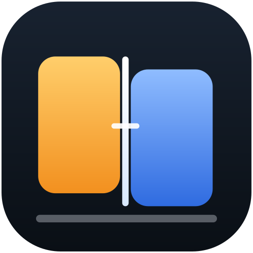

  

  
  
  
  

<strong>BlinkTable — a workspace for serious image and video comparison: compare, measure, prove.</strong>

Read this in other languages: <a href="README.ru.md">Русский</a>

---

## What it is

BlinkTable opens on a session picker and gives you independent workspace tabs:
a two-image **Image Compare**, a synchronized N-image **Multi Compare**, and an
**Image Gallery** for triaging, measuring and AI-scoring whole folders. Each tab
owns its canvas, state, help pages and export pipeline.

It is not a viewer with a slider. The comparison *is* the product: split, zoom,
magnifiers, diff modes, objective metrics, video capture of a session, and an
export that matches what is on screen.

## Why it is different

- **Comparison first.** Split, pan/zoom, multi-magnifier, WASD/QE navigation and a
  live single-image preview are the primary interactions, not settings buried in a menu.
- **Analysis, not just eyeballing.** Highlight / grayscale / edge / SSIM diff modes,
  PSNR + SSIM metrics per pair, and an optional **AI quality scorecard** (VLM) that
  scores a folder on several axes — plus **Ask AI** about a selection.
- **Export parity.** The exported image is the composed view: splitters, overlays,
  magnifiers, styled names — including video export of a recorded session.
- **Keyboard-first, agent-drivable.** Every surface is reachable from the keyboard,
  and a running instance can be driven by an LLM agent through the built-in
  **MCP / control surface** (element inventory, clicks, keys, captures, logs).

## Preview

  

---

## Features

### Compare

- **Image Compare / Multi Compare tabs** — two images side by side, or any number of
  images in one scene with draggable slots and freely resizable dividers.
- Smooth GPU zoom and pan, horizontal/vertical split, synced pan/zoom across sides,
  channel view modes, fullscreen focus for any cell.
- **Magnifiers** — dual or combined circle, internal split control, subpixel-stable
  rendering, EWA Lanczos, freeze mode, guide "lasers"; place as many as you need,
  each with its own area, position, size, colors and freeze state.
- Instant single-image preview: <kbd>Space</kbd> + mouse buttons.

### Analyze

- Diff modes: **highlight, grayscale, edge comparison, SSIM map**; PSNR/SSIM metrics
  for objective checks.
- **AI quality scorecard** — a VLM reads the compared images and returns per-axis
  scores + a verdict; requires an API key in **Settings → AI**. Results are cached
  per backend, so switching model or endpoint re-analyzes instead of showing stale scores.
- **Ask AI** about a card or a selection, with the answer scoped to what you picked.
- Gallery triage: sort, rank, reject/keep, group series, reset metric caches, Clean Review.

### Capture and export

- **WYSIWYG export**: splitters, magnifier, overlays and styled file names exactly as
  composed — PNG, JPEG, WEBP, BMP, TIFF, JXL.
- **Session recording + video editor**: capture a comparison session, trim or delete
  timeline ranges, keyframe states, export to MP4, WebM, AVI, GIF, ProRes, AV1.
- Export jobs report progress and can be cancelled without leaving a zombie row.

### Platform and UI

- **Tabbed workspace** with a Firefox-style tab bar; a session picker on start; project
  files (`.imgsli`) that keep images, splitters, magnifiers and video sessions together.
- The project's own **custom-drawn UI toolkit** (no QSS): light/dark themes, custom
  fonts, and a live UI scale (0.5–2.5×) that re-derives geometry instead of stretching it.
- Four UI languages (EN / RU / ZH / pt_BR), tray integration, save notifications,
  a launcher for source runs, and a robust auto-crop pipeline.

### Agent control (MCP)

- A live **control channel** (`IMGSLI_CONTROL=1`) plus an MCP server: 23 tools to
  inventory elements, read Store/actions/log/tracer, click, press keys, navigate
  keyboard sections, list/cancel jobs, set theme/language, capture surfaces, and
  **wait** for an asynchronous state instead of polling.
- Designed for honest instrumentation: every result says whether it came from a live
  instance, captures carry their method and canvas-layer count, and keyboard
  reachability is measured (`ui_nav_state` + `nav_key`), not guessed.
- Start here: [docs/dev/MCP.md](docs/dev/MCP.md).

---

## Install

| Platform | How |
|---|---|
| Windows | latest installer from [Releases](https://github.com/Loganavter/Improve-ImgSLI/releases/latest) |
| Linux (Flatpak) | `flatpak install io.github.Loganavter.Improve-ImgSLI` then `flatpak run io.github.Loganavter.Improve-ImgSLI` |
| Linux (AUR) | `yay -S improve-imgsli` |
| From source | `git clone … && cd Improve-ImgSLI && ./launcher.sh run` |

Full instructions: [docs/INSTALL.md](docs/INSTALL.md) · launcher reference: [docs/LAUNCHER.md](docs/LAUNCHER.md).

Current bound: images above `65536 px` on a side are rejected on the bounded decode
path (streaming decode has no such bound); still-image export above `16384 px`
warns that the path is untested.

## First five minutes

1. Start the app — the session picker opens; choose **Image Compare**, **Multi Compare**
   or the **Image Gallery** (each becomes its own tab).
2. Press <kbd>Ctrl</kbd>+<kbd>Shift</kbd>+<kbd>P</kbd> — **Find Action** runs any command
   by name; "Learn more" opens the matching Help topic.
3. In Image Compare, add images (button or drag-and-drop), then move the split line and
   zoom with the wheel; <kbd>Space</kbd> + LMB/RMB previews one side.
4. Open the magnifier, pick interpolation, adjust zoom; export the composed view.
5. In the Gallery, analyze a folder: metrics for every pair, and the AI scorecard when
   an API key is configured.

Hotkeys, settings and the full workflow live in the in-app **Help** (Help menu) —
sources: [EN host topics](src/resources/help/en/) · [RU](src/resources/help/ru/) ·
[Image Compare](src/tabs/image_compare/resources/help/en/) ·
[Multi Compare](src/tabs/multi_compare/resources/help/en/) ·
[Gallery](src/tabs/image_gallery/resources/help/en/).

## Docs map

| You want | Read |
|---|---|
| Install / launcher | [docs/INSTALL.md](docs/INSTALL.md), [docs/LAUNCHER.md](docs/LAUNCHER.md) |
| Drive the app from an agent | [docs/dev/MCP.md](docs/dev/MCP.md) |
| Contribute / dev setup | [CONTRIBUTING.md](CONTRIBUTING.md) |
| Architecture, contracts, patterns | [docs/dev/ARCHITECTURE.md](docs/dev/ARCHITECTURE.md), [docs/dev/CONTRACTS.md](docs/dev/CONTRACTS.md) |
| Project vision & history | [VISION.md](VISION.md), [docs/DEVELOPMENT_HISTORY.md](docs/DEVELOPMENT_HISTORY.md) |
| Open engineering debt | [docs/dev/TODO.md](docs/dev/TODO.md) |

## Contributing

Contributions are welcome — see [CONTRIBUTING.md](CONTRIBUTING.md) for setup, coding
guidelines and packaging notes. Issues and PRs: GitHub.

## Maintainers

<table>
  <tr>
    <td align="center" valign="top" width="140">
      <a href="https://github.com/nebulosa2007" title="GitHub profile">
         
        <b>Nebulosa</b>
      </a>
    </td>
    <td valign="top">
      <strong>AUR Package Maintainer</strong>
      
A massive thank you to Nebulosa for maintaining the <a href="https://aur.archlinux.org/packages/improve-imgsli">Arch Linux (AUR)</a> package from the start — packaging fixes and stability work that keep the project reliable in the Arch ecosystem.

      
      
    </td>
  </tr>
</table>

## License

GPL-3.0-or-later — see [LICENSE](LICENSE). Runtime dependencies (including
PySide6/Qt under LGPL-3.0-or-later) are listed in [THIRD_PARTY_LICENSES.md](THIRD_PARTY_LICENSES.md).

## Star History

