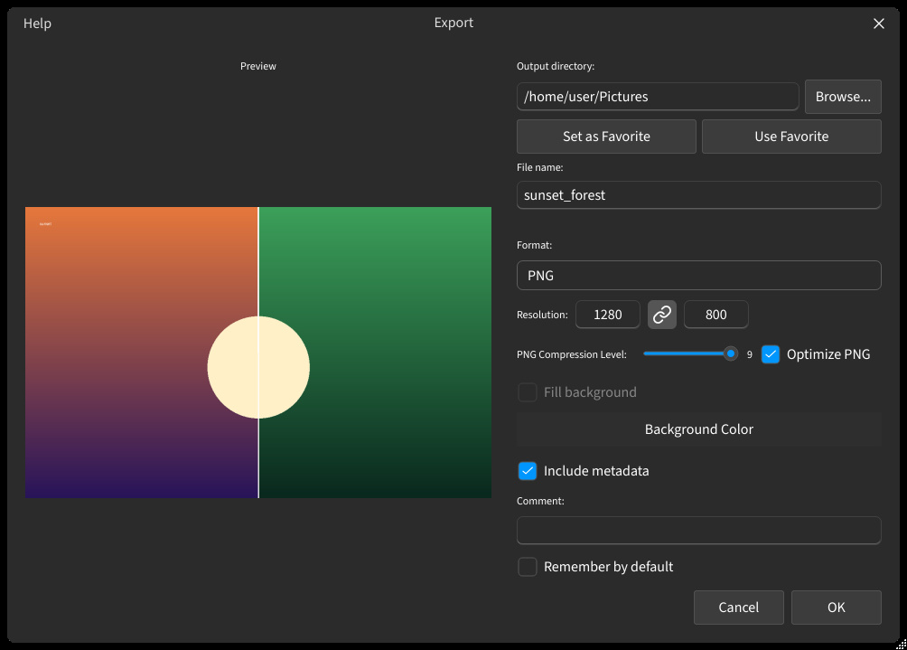

## Exportação

Exportação do canvas atual como imagem estática. Captura de sessão e codificação de vídeo pertencem a outro tópico: [Editor de vídeo](help://workspace.image_compare.video).

### Salvar uma imagem {#saving-an-image}

{{tr:image_compare.action.save}} (barra de ferramentas ou {{tr:menu.find_action}}) abre o diálogo de exportação.

- **Caminho** — pasta de saída e nome do arquivo.
- **Formato** — PNG, JPEG, WEBP, BMP, TIFF ou JXL.
- **Pré-visualização** — o painel ao vivo mostra o resultado composto antes de gravar.

:::figure{side=block width=630}

{{tr:image_compare.action.breadcrumb.toolbar}} → {{tr:image_compare.action.breadcrumb.export}}.
:::

### Resolução e qualidade {#resolution-and-quality}

- **Tamanho** — campos de largura e altura com trava de proporção.
- **Qualidade** — {{tr:label.quality}} aparece só para formatos com perda.
- **PNG** — nível de compressão e {{tr:export.optimize_png}}.
- **Preenchimento** — {{tr:export.fill_background}} pinta as margens quando o canvas virtual ultrapassa `0..1`. No canvas unitário a opção desliga.

### Metadados e favoritos {#metadata-and-favorites}

- **Metadados** — {{tr:export.include_metadata}} fica ligado até ser desligado; o campo de comentário some junto. {{tr:export.remember_by_default}} guarda o texto do comentário para a próxima exportação.
- **Favoritos** — {{tr:misc.set_as_favorite}} fixa a pasta atual; {{tr:tooltip.use_favorite}} a recupera.
- **Rótulos** — quando {{tr:image_compare.action.file_names}} está ligado, os nomes saem na imagem como estado da sessão, não como dados do arquivo.

### Salvamento rápido {#quick-save}

- **`Ctrl+S`** — {{tr:image_compare.action.quick_save}} repete as últimas configurações sem abrir o diálogo.
- **Bandeja** — o menu do ícone na bandeja reabre o último arquivo e a última pasta salvos.

### Gravação e vídeo {#video-editor}

Controles de gravação e codificação de vídeo/GIF ficam no [Editor de vídeo](help://workspace.image_compare.video).
