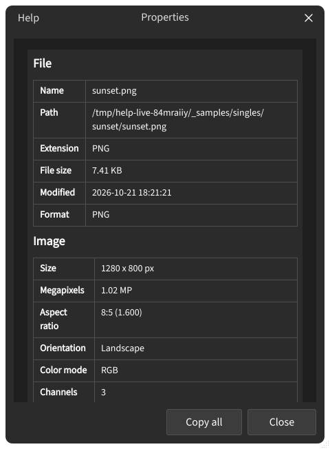

## Image Properties

**Properties** shows the file details and how the image is used in the current session. The dialog only displays data; it changes nothing in the session.

### Open the dialog {#open}

Right-click an image in a list or slot and choose **Properties** in the context menu.

:::figure{side=block width=280}

The **Properties** dialog: rows are grouped by source, and each row has its own copy button.
:::

### What is shown {#sections}

Rows are grouped into:

- **File** — name, path, size on disk, format, and modified time.
- **Image** — pixel size, aspect, orientation, channels; color mode and profile when the file provides them.
- **In app** — how the app places this image in the current session (see below).
- **Metadata** — camera and EXIF-style fields when the file provides them.

Rows without values are omitted. If the file cannot be read, **Read error** appears instead of the data.

### In-app context {#in-app}

The **In app** group depends on the session type:

- In an **Image Compare** session it shows **Side** (left or right) and **Rating**.
- In a **Multi Compare** session it shows the cell's **Position**.

These rows describe session state, not the file on disk.

### Close {#close}

**Close** dismisses the dialog. **Copy all** copies every visible row to the clipboard; each row also offers its own copy button.
