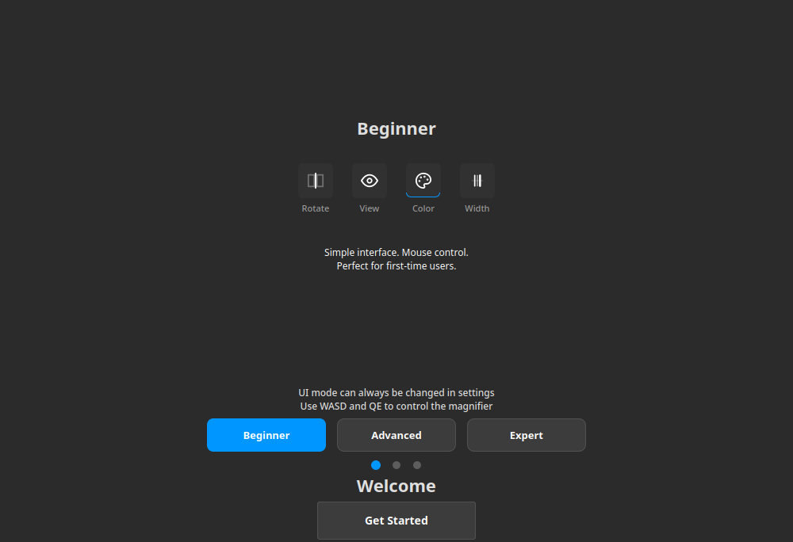

## 入门

BlinkTable 把图像并排放在一起，让你对比它们、放大查看差异，并保存结果。

### 第一次比较 {#basic-workflow}

:::figure{side=block width=100%}

首次启动：**初学者**、**高级** 和 **专家** 模式卡片，各自展示自己的工具栏示例，下方是确认按钮。
:::

1. 首次启动时，选择界面模式 —— **初学者**、**高级** 或 **专家**。该选择保存一次，之后可以在 **外观** 下更改。
2. 按 `Ctrl+N` 打开会话（**会话选择器**），或从 **查找操作**（`Ctrl+Shift+P`）运行 **新建图像对比会话**。
3. 往两个列表中各载入一张图像：使用列表上的添加按钮，或把文件拖到列表上。
4. 在画布上拖动 **分割线**，让一张图像盖住另一张；再按 `M` 开启[放大镜](help://workspace.image_compare.magnifier)，点击图像即可放大。
5. 按 `Ctrl+S` 保存结果，或打开[视频编辑器](help://workspace.image_compare.video)（`Ctrl+E`）录制对比过程，代替静态图。

### 多图比较 {#multi-compare}

图像有三张或更多时，使用 **多图比较**：一个由槽位组成的网格，每个槽位放一张自己的图像。从 **会话选择器** 打开它，或从 **查找操作** 运行 **新建多图对比会话**，然后用 `Ctrl+O` 添加图像并填入槽位。布局、焦点和网格的保存方式见[多图对比概览](help://workspace.multi_compare.overview)。

### 发现更多功能 {#discover}

按 `Ctrl+Shift+P` 打开 **查找操作**，用名称运行任何操作；**了解更多** 会打开对应的帮助主题。可以先读[对比](help://workspace.image_compare.comparison)，了解分割线、标签和差异模式；再读[文件与项目](help://platform.file_project)，学会把工作保存为可移植的 `.imgsli` 项目。
