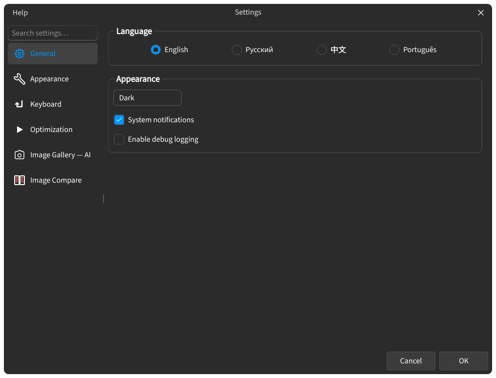

## Настройки

Настройки собирают параметры приложения в одном диалоге: встроенные страницы, например **Общие** и **Внешний вид**, плюс секции, которые добавляют вкладки. Секции вкладок видны всегда, независимо от активной сессии.

:::figure{side=block width=100%}

Список разделов слева и открытая страница **Общие** — **Язык**, **Тема**, **Системные уведомления** и **Включить отладочные логи**.
:::

### Открыть настройки {#open-settings}

- **Файл** → **Настройки** (`Ctrl+,`).
- **Найти действие** — `Ctrl+Shift+P`, затем имя страницы (**Общие**, **Внешний вид**, **Клавиатура**, …).
- **Подробнее** — у действия настроек открывает тему справки этого действия.

### Поиск в настройках {#search}

Поле поиска над списком разделов показывает по одной строке на раздел, как бы глубоко ни лежало совпадение (имя элемента, название группы, любой язык). Выбор строки открывает раздел и подсвечивает найденные параметры. `Esc` очищает поиск и возвращает полный список.

### Общие {#general}

- **Язык** — язык интерфейса: en, ru, zh или pt_BR.
- **Тема** — auto, light или dark.
- **Системные уведомления** — включает уведомления операционной системы.
- **Включить отладочные логи** — записывает подробные логи для отладки.

### Внешний вид {#interface}

- **Режим интерфейса** — **Начинающий**, **Продвинутый** или **Эксперт**; по умолчанию выбран **Начинающий**, и сюда же попадает выбор первого запуска.
- **Шрифт интерфейса** — встроенный, системный или свой шрифт.
- **Масштаб интерфейса** — размер элементов интерфейса, от 0.5 до 2.5.
- **Макс. длина имени (в UI)** — ограничивает длину отображаемого имени.

### Производительность {#performance}

- **Бэкенд** — графический бэкенд; доступные варианты зависят от платформы, а смена может потребовать перезапуск.

### Сравнение изображений {#image_compare}

Параметры сравнения доступны всегда:

- **Интерполяция зума** — качество пересчёта для зума.
- **Перемещение лупы** — сохраняет плавность следования линзы за указателем при перетаскивании; строка **Сглаживание лазеров** ниже сглаживает направляющие лупы. У каждой строки свой метод.
- **Красная подсветка пересечения луп** — пока лупа перетаскивается, подсвечивается скрытая под другими лупами часть её кольца захвата; **Автопокраска новых луп** назначает каждой новой линзе свой цвет.
- **FPS записи** — частота захвата для [Видеоредактора](help://workspace.image_compare.video).
- **Автоматически обрезать черные рамки при загрузке** — обрезает чёрные поля при загрузке изображения.
- **Авто-расчет PSNR** / **Авто-расчет SSIM** — автоматический подсчёт метрик, по умолчанию выключен.

### Галерея — ИИ {#image-gallery-ai}

ИИ-возможности в [Галерее](help://workspace.image_gallery.triage) используют настройки ниже. Для запроса нужны включённый переключатель, API-ключ и модель; одного ключа недостаточно. Ключ не записывается в файл настроек: он хранится в системном хранилище ключей, если оно доступно, иначе — только до конца сеанса. Прогонов на карточку: анализ может спросить модель 1, 2, 3 или 5 раз и берёт медиану — больше прогонов дают устойчивее оценки при пропорционально большей стоимости, но близкие варианты всё равно могут поменяться местами.

- **Включить ИИ-анализ изображений** — включает или выключает ИИ-возможности.
- **Базовый URL API** — адрес ИИ-сервиса.
- **API-ключ** — учётные данные для этого сервиса.
- **Название модели** — модель, к которой ИИ обращается с запросами.
- **Лимит токенов ответа** и **Глубина рассуждений** — пределы ответа: ограничение длины (пусто = авто) и то, сколько модель рассуждает перед ответом.
- **Уменьшение изображений (макс. сторона)** — наибольшая сторона, отправляемая модели; **Оригинал** сохраняет исходные байты файла.
- **Прогонов на карточку** — сколько независимых оценок получает каждая карточка (1, 2, 3 или 5). Каждый прогон — ещё один вызов изображения, поэтому больше прогонов дают устойчивее оценки при пропорционально большей стоимости; близкие варианты всё равно могут поменяться местами даже при 5.

### Клавиатура {#keyboard}

Ярлыки сгруппированы по владельцам — **Платформа**, затем группа на каждую вкладку, например **Сравнение изображений**. **Сброс** возвращает один ярлык или все сразу. Фиксированные клавиши холста `WASD` и `Space` не переназначаются — см. [Горячие клавиши](help://platform.hotkeys).
