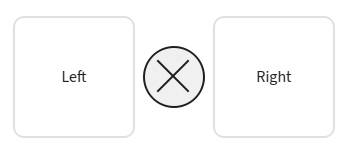

## Файлы и проекты

Здесь собрано, как загружать изображения в сессии, вставлять их из буфера обмена и открывать или сохранять портативный проект — файл, который хранит раскладку сессий, настройки сравнения и копии исходных изображений.

### Загрузка изображений {#loading-images}

- **Доб. Изобр(ы) 1** / **Доб. Изобр(ы) 2** — кнопки добавления у левого и правого списков открывают выбор файлов; возьмите одно изображение или несколько для этой стороны.
- **Добавить изображения** — в сессии **Мультисравнение** одна кнопка добавления загружает изображения в сетку.
- **Перетаскивание** — перетащите файлы в окно, и они попадут в список на стороне под курсором.
- **Вставка из буфера** (`Ctrl+V`) — изображение из буфера обмена вставляется в активную сессию. Появляется подсказка направления: клик по стрелке выбирает сторону списка, `Esc` отменяет вставку.

:::figure{side=block width=280}

После `Ctrl+V` появляется подсказка: стрелка направляет изображение в левый или правый список, `Esc` отменяет вставку.
:::

### Списки {#lists}

- В сессии **Сравнение изображений** левый и правый списки независимы. Панель списка задаёт порядок, рейтинг и переименование, показывает путь и свойства, позволяет удалять изображения; подробнее: [Сравнение](help://workspace.image_compare.comparison).
- В сессии **Мультисравнение** вместо двух списков изображения раскладываются по слотам: перетащите файл в нужный слот. Подробнее: [Обзор мультисравнения](help://workspace.multi_compare.overview).

Каждая сессия получает отдельную вкладку — см. [Вкладки](help://platform.tabs).

### Проекты {#projects}

Проект — это портативный файл `.imgsli`, который переносит состояние рабочей области между запусками и компьютерами: открытые сессии, настройки сравнения и копии исходных изображений.

- **Открыть проект** — **Открыть проект** в меню **Файл**, `Ctrl+Shift+O` или **Найти действие**. Открытый проект называет активную вкладку именем файла и восстанавливает сессии, настройки сравнения (**Разделитель**, режимы различий, **Лупа** и связанные возможности) и встроенные копии изображений.
- **Сохранить проект** — `Shift+S` пишет изменения в текущий файл; если проект ещё не сохраняли, вместо этого открывается **Сохранить проект как…**. Сохранение также обновляет имя файла, если вкладку переименовали.
- **Сохранить проект как…** — `Ctrl+Shift+S` предлагает имя переименованной вкладки, а иначе — **Без названия**.
- **Что содержит файл** — ZIP-архив: `project.json` с сессиями и папка `media/` с встроенной копией каждого изображения.
- **Если исходник пропал** — когда путь из списка больше не существует, проект всё равно сохраняется; это изображение пропускается, а предупреждение называет его.
- **Что не сохраняется** — **Тема**, **Язык** и горячие клавиши остаются в настройках приложения и не входят в файл проекта.

### Двойной клик по файлу в Windows {#windows-file-association}

Установщик связывает `.imgsli` с Improve ImgSLI, поэтому двойной клик открывает проект, а файл получает значок документа приложения. Сборка для Windows также регистрирует связь при каждом запуске.

Если в свойствах файла по-прежнему указано «Выбор приложения», выберите Improve ImgSLI вручную один раз или запустите приложение с `--register-file-types`.
