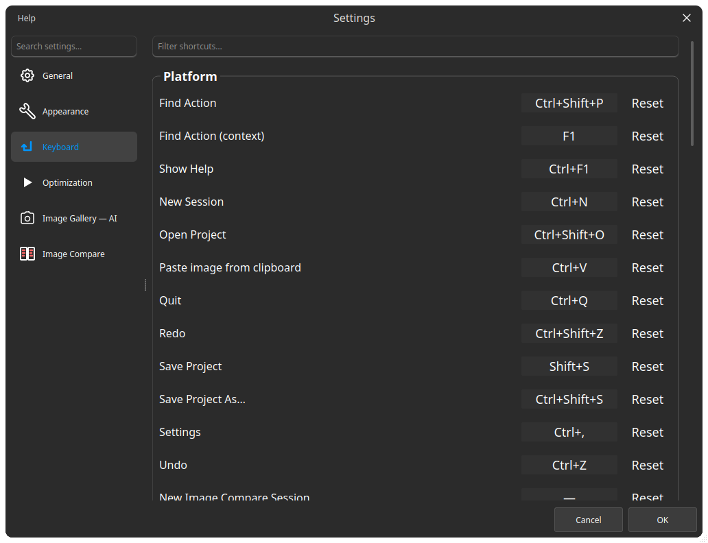

## 快捷键

以下是默认组合键。大多数操作的快捷键可在 **设置** → **键盘** 中重新绑定；画布按键 `WASD` / `QE`、方向键、`Space` 以及 `+` / `-` 是固定的，无法重新绑定。

:::figure{side=block width=100%}

**设置 → 键盘**：每个平台操作及其组合键和一个 **重置** 按钮；下面按标签页分组。
:::

### 先搜索，再记忆 {#discover}

`Ctrl+Shift+P` 加上名称的一部分，比逐个翻找列表更快：**查找操作** 会运行匹配的操作，或为图文主题打开 **了解更多**。`F1` 为焦点控件打开帮助主题。

### 平台 {#platform}

- `Ctrl+,` — **设置**
- `Ctrl+F1` — **显示帮助**
- `Ctrl+N` — **新建会话**（打开 **会话选择器**）
- `Ctrl+Tab` / `Ctrl+Shift+Tab` — 下一个 / 上一个会话
- `Ctrl+Shift+P` — **查找操作**
- `Ctrl+V` — **从剪贴板粘贴图像**
- `Ctrl+Shift+O` / `Shift+S` / `Ctrl+Shift+S` — **打开项目** / **保存项目** / **项目另存为…**（`.blinktable`）
- `Ctrl+Q` — **退出**

菜单标签跟随所选语言。自定义快捷键在 **设置** → **键盘** 的「平台」分组中设置。

### 图像比较 {#image-compare}

- `M` / `F` — **切换放大镜** / **冻结放大镜**
- `N` / `D` — **文件名叠加** / **分割线可见性**
- `H` / `C` — **差异模式** / **通道模式**
- `X` — **交换图像**
- `R` / `Ctrl+E` — **录制视频** / **视频编辑器**
- `Ctrl+S` — **快速保存**
- `WASD` / `QE` — 移动放大镜 / 调整间距（固定）
- `Shift+Space` — 在组合模式下预览一侧（固定）
- `←↑↓→` / `+` / `-` — 平移 / 缩放（固定）

详情：[对比](help://workspace.image_compare.comparison)、[放大镜](help://workspace.image_compare.magnifier)、[视频编辑器](help://workspace.image_compare.video)。

### 多图比较 {#multi-compare}

- `Ctrl+O` — **添加图像**
- `D` — **网格可见性**
- `Ctrl+S` — **快速保存**
- `Esc` — 退出槽位焦点
- `←↑↓→` / `+` / `-` — 平移 / 缩放（固定）

见 [多图比较](help://workspace.multi_compare.overview)。

### 图库 {#image-gallery}

- `Space` / `Delete` — 从网格中移除所选图像；文件仍保留在磁盘上。

见 [分拣与审阅](help://workspace.image_gallery.triage)。

### 视频编辑器窗口 {#video-editor}

编辑器窗口打开时：

- `Space` — 播放或暂停
- `Ctrl+Z` / `Ctrl+Y` — 撤销 / 重做
- `Delete` / `Backspace` — 删除选中的范围

完整编码流程：[视频编辑器](help://workspace.image_compare.video)。

### 键盘导航 {#keyboard-navigation}

- `F1` — 为焦点控件打开帮助主题；无法解析主题的控件会回退到 **查找操作**（有匹配项时会高亮该操作）。
- 在 **查找操作**（`Ctrl+Shift+P`）中：`↑` / `↓` 移动选择，`Enter` 运行，`Ctrl+Enter` 打开 **了解更多**，`Esc` 关闭列表。
- 在 **多图比较** 概览中，槽位焦点跟随指针：单击切换单图聚焦，`Esc` 退出。方向键用于平移画布，而不会在槽位之间移动焦点。
- 在 **会话选择器** 中，方向键在卡片之间移动焦点，`Enter` 打开聚焦的卡片，效果与单击该卡片相同。
- 画布槽位之间没有 `Tab` 遍历：焦点跟随指针，键盘通过 **查找操作** 驱动操作。
