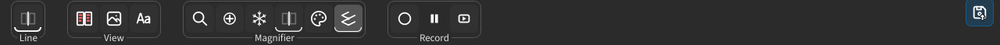
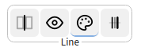

## 按钮与控件

**工具栏** 位于对比会话画布上方，承载当前会话的工具：**分割线**、视图模式、**放大镜** 和 **录制**。列表、添加与保存、以及设置齿轮则在窗口两侧的边栏中。

### 工具栏 {#toolbar}

- **工具栏** — 画布上方的一排图标控件，可执行当前会话的主要操作。
- **内容** — 包含切换、数值微调，以及为当前会话类型打开面板或对话框的按钮。
- **疏密** — 工具栏的疏密由 **UI模式** 决定：可在首次启动引导中选择，之后随时在 [设置 → 外观](help://platform.settings#interface) 中更改。

:::figure{side=block height=107}

对比会话画布上方的工具栏，从左到右依次是分割线、视图与放大镜等控件。
:::

### 界面模式 {#ui-modes}

同一套工具在三种 **UI模式** 下布局不同。可在首次启动引导时选择一次，之后随时在 [设置 → 外观](help://platform.settings#interface) 中更改。下面按模式说明工具栏的排列。

#### 初学者 {#mode-beginner}

独立按钮更多，一个控件通常只负责一个操作。

:::figure{side=block height=65}

初学者模式下的工具栏：每个操作几乎都有独立按钮。
:::

#### 高级 {#mode-advanced}

图标更少；部分控件把单击与滚轮组合在一起，例如方向与粗细。

:::figure{side=block height=65}

高级模式下的工具栏：图标更少，部分控件把单击和滚轮组合在一起。
:::

#### 专家 {#mode-expert}

最紧凑：同一个控件组合了单击、滚轮和其他鼠标按键。

:::figure{side=block height=65}

专家模式下的工具栏：最紧凑，同一个控件组合了单击、滚轮和其他鼠标按键。
:::

### 同一控件上的多种操作 {#multi-action}

在 **高级**，尤其是 **专家** 模式下，同一个图标经常对应多项操作：

- **单击** — 主要操作或切换。
- **滚轮** — 微调数值（分割线粗细、放大镜大小等），无需打开对话框。
- **长按** — 部分列表按钮的强化操作，例如清空整个列表或交换两侧列表。
- **其他鼠标按键**（**专家** 模式）— 例如在紧凑的分割线控件上右键取色、中键重置。

**初学者** 模式则把同一批任务拆成独立按钮，而不是叠在同一个控件上。

:::figure{side=block height=44}

列表按钮上的长按：单击执行主要操作，长按触发强化操作。
:::

### 产品示例 {#examples}

- **图像比较** — 在更紧凑的模式下，可在同一控件上滚动调整分割线宽度或放大镜大小；列表按钮支持长按清空 / 交换。详情见[对比](help://workspace.image_compare.comparison)。
- **多图比较** — 网格线的粗细与可见性通过 `D` 键和紧凑控件调整。详情见 [多图比较](help://workspace.multi_compare.overview)。

### 按名称查找控件 {#find-action}

按 `Ctrl+Shift+P` 打开 **查找操作**，输入操作名称的一部分，然后运行找到的操作；若该行带有帮助主题，可打开 **了解更多** 或按 `Ctrl+Enter`。
