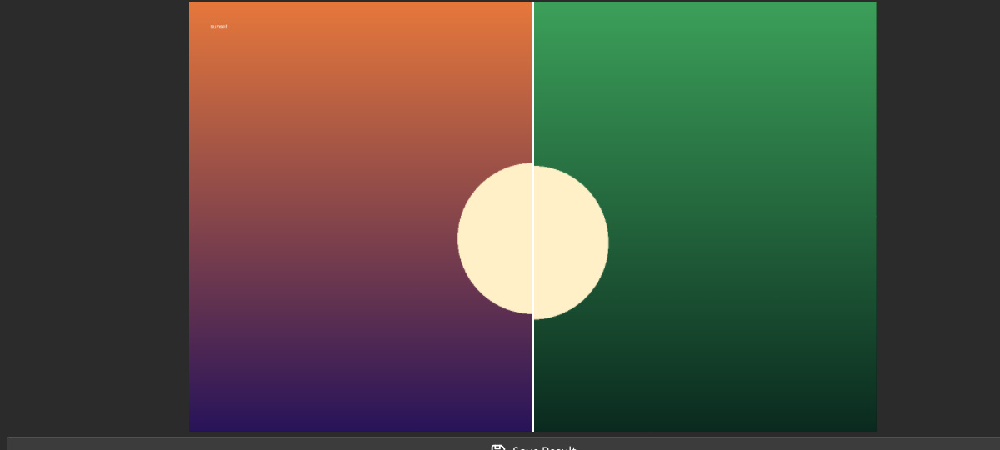
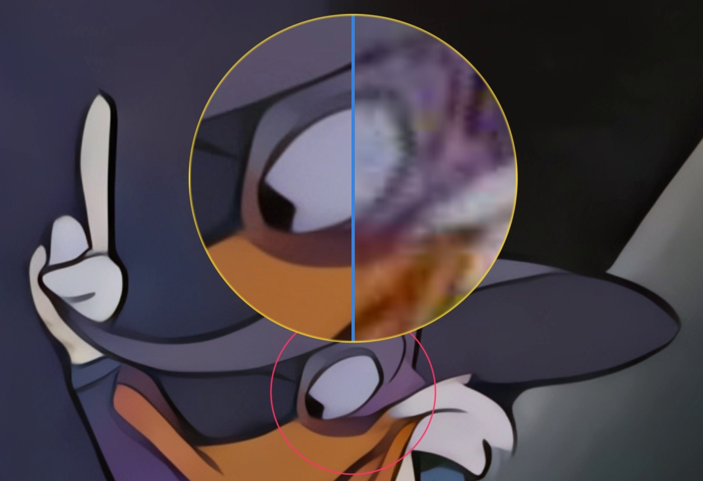

## Lupa

A lupa amplia uma região escolhida das duas imagens comparadas, para estudar detalhes pequenos demais no canvas.

### Ativar {#enabling}

- **Alternar lupa** (`M`) — mostra ou oculta a lente no canvas. Os outros controles desta página valem apenas enquanto a lente está visível.
- **Anel de captura** — o anel vermelho ao redor da região que a lente amplia. Clique ou arraste sobre a imagem para mover essa região.

:::figure{side=block width=280}

As duas metades da lupa no canvas, e o **Anel de captura** vermelho sobre a imagem.
:::

### Tamanho e movimento {#size-and-movement}

- **Tam. Lupa (%)** — o tamanho com que a lente é desenhada no canvas.
- **Tam. Captura (%)** — quanto da imagem a lente amostra; um valor maior mostra mais imagem com um aumento menor.
- Com a lente visível, `WASD` a move pela imagem, e `QE` muda a distância entre as suas duas **metades** enquanto estão separadas. As metades são as duas partes da lente; cada uma mostra uma das imagens comparadas.
- **Velocidade de Movimento** — a rapidez com que a lente se move enquanto uma tecla `WASD` é mantida; o controle fica no painel da lupa, exibido com a lente.

### Congelar {#freeze}

**Congelar lupa** (`F`) fixa a lente no ponto atual do canvas, para que o **Anel de captura** se mova sem que a lente o acompanhe. Pressione `F` de novo para soltar a lente.

### Divisor, guias e cores {#guides-and-colors}

- **Orientação da lupa** — alterna as duas metades entre lado a lado e empilhadas.
- **Divisor da lupa** — define orientação, espessura e cor da divisão dentro da lente (rolagem / botão direito).
- **Visibilidade do divisor da lupa** e **Guias da lupa** — mostram ou ocultam essa divisão e as guias; a espessura das guias é definida à parte.
- **Cores da lupa** — define a cor do contorno da lente.

### Várias instâncias {#instances}

- **Instâncias da lupa** — adiciona e remove lentes para observar várias regiões ao mesmo tempo.
- **Colorir novas lupas automaticamente** — com esta opção ligada nas [Configurações](help://platform.settings#image_compare), cada nova lente recebe a própria cor de contorno.

### Modo combinado {#combined-mode}

Quando as duas metades seguem visíveis e o espaçamento entre elas chega ao limiar de combinação, elas se fundem em uma única lente.

- **Divisão interna** — arraste com o botão direito do mouse dentro da lente fundida para mover a divisão entre as metades.
- **Pré-visualização de lado** — `Shift` + `Space` força temporariamente um lado a preencher a lente fundida.

:::figure{side=block width=280}

A lente combinada: as duas metades fundidas em uma.
:::

Para comparar o canvas inteiro sem a lente, veja [Comparação](help://workspace.image_compare.comparison).

### Configurações que afetam a lupa {#related-settings}

Opções relacionadas à lupa ficam nas [Configurações](help://platform.settings#image_compare):

- **Movimento da lupa** — mantém suave o seguimento da lente pelo cursor durante o arrasto.
- **Suavização de laser** — suaviza as guias da lupa.
- **Destaque vermelho para lupas sobrepostas** — marca a parte de uma lente que outra lente sobrepõe.
- **Colorir novas lupas automaticamente** — dá a cada nova lente a própria cor de contorno.
