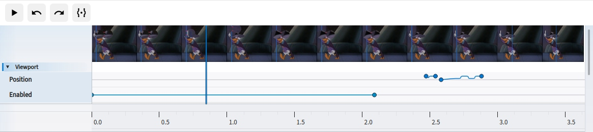
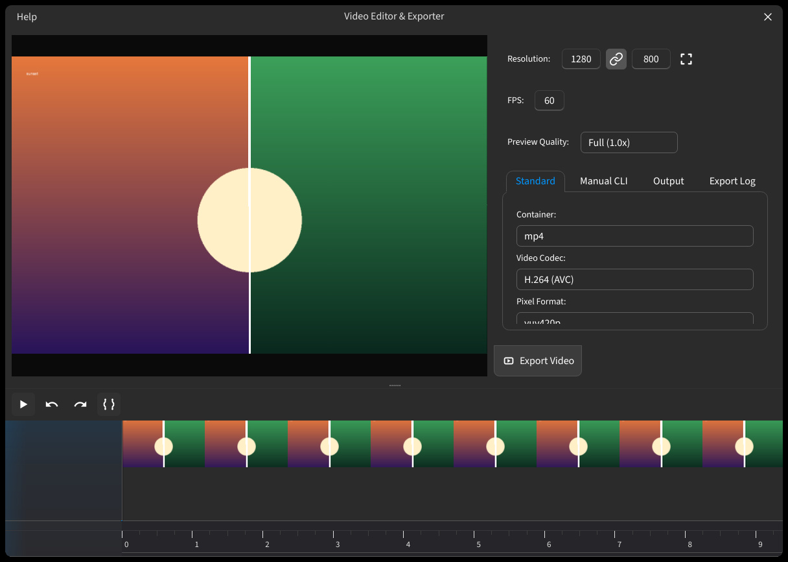

## Видеоредактор

Записывайте живую сессию **Сравнение изображений** как дорожки контролов, обрезайте таймлайн и кодируйте результат в видео или GIF. Отдельные кадры по-прежнему сохраняются в [Экспорте](help://workspace.export).

### Запись сессии {#recording}

- **Управление** — **Запись видео** (`R`) начинает запись, **Пауза записи** приостанавливает её, те же контролы останавливают запись.
- **Что пишется** — действия на холсте во времени (зум и панорамирование, разделитель, лупа, изображения, настройки) как дорожки контролов с точками записи, а не сырой скринкаст.
- **Частота** — число кадров в секунду задаётся на странице [Настройки](help://platform.settings#image_compare), параметр **FPS записи**.

### Открыть редактор {#open-editor}

После остановки записи откройте **Видеоредактор** (`Ctrl+E`): он листает кадры, правит диапазон и экспортирует. Команды редактора можно найти через **Найти действие**.

### Правка таймлайна {#timeline}

- **Листать** — перетаскивайте маркер времени, чтобы перемещаться по записи.
- **Диапазон** — `Shift`+перетаскивание задаёт отрезок; за края (ручки) выделение растягивается, за середину сдвигается. **Обрезать по выделению** оставляет в проекте только выбранный отрезок.
- **Удалить** — удаляет выделение (`Delete` или `Backspace`).
- **Воспроизведение** — `Space` запускает и приостанавливает проигрывание; отмена и повтор — `Ctrl+Z` и `Ctrl+Y`.

:::figure{side=block width=840}

Шкала времени видео: сверху дорожки контролов с точками записи, снизу — индикатор времени и выделение.
:::

### Треки и что попало в запись {#tracks}

Дорожки инструментов (разделитель, лупа, область просмотра и т. п.) показывают, как контролы менялись во времени. Между точками записи редактор плавно склеивает значения, чтобы воспроизведение совпадало с живой сессией. Для лупы записываются отдельные дорожки **Capture Position** (центр кольца захвата на изображении) и **Offset** (смещение лупы относительно захвата) — так они подписаны в редакторе.

### Качество предпросмотра {#preview-quality}

**Качество предпросмотра** влияет только на превью внутри редактора и не попадает в финальный файл.

- **Полное (1.0x)** — самое чёткое превью; больше нагрузка; включено по умолчанию.
- **Сбалансированное (0.75x)** — компромисс между качеством и нагрузкой для большинства сессий.
- **Производительное (0.5x)** — легче, если прокрутка таймлайна тормозит.
- **Черновое (0.25x)** — самое быстрое превью; меньше деталей.

### Экспорт видео или GIF {#export-encode}

- **Кадр** — задаёт разрешение итогового файла; при необходимости включает сохранение пропорций и режим вписать или обрезать кадр. FPS не может превышать частоту записи. Пустые края можно закрыть заливкой фона.
- **Кодек** — выбирает контейнер и кодек на стандартной вкладке; аппаратные варианты доступны, только если система их отдаёт.
- **Качество** — задаётся значением CRF или CQ либо битрейтом и пресетами.
- **Путь** — файл назначения; кнопки избранных папок подставляют нужный каталог.
- **Прогресс** — экспорт можно остановить, а лог показывает сообщения энкодера.

:::figure{side=block width=630}

Панель экспорта: настройки кадра, кодека, качества и пути, а также прогресс кодирования.
:::

### Ручной ввод CLI {#manual-cli}

Вкладка **Ручной ввод CLI** передаёт сырые аргументы FFmpeg на выход, когда возможностей стандартной вкладки мало. Проверки интерфейса здесь не применяются: неверные аргументы приведут к ошибке экспорта.

### Дальше по темам {#next-topics}

Отдельные кадры: [Экспорт](help://workspace.export). Режимы различий и лупа при записи совпадают с холстом — [Сравнение](help://workspace.image_compare.comparison) и [Лупа](help://workspace.image_compare.magnifier).
