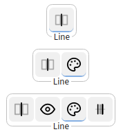
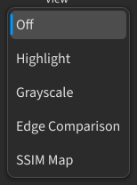

## 对比

对比把两张图像并排显示，让同一处细节在两侧对齐。

### 分割线 {#split-line}

**分割线** — 两张图像之间的可移动边界。在图像对上拖动它，让两张图像的同一位置在边界处对齐。

- **分割方向** — 在水平与垂直之间切换分割方式。
- **分割线宽度** — 在其上滚动鼠标滚轮，即可改变边界的粗细。
- **分割线颜色** — 设置边界的颜色。
- **分割线可见性**（`L`）— 显示或隐藏边界。
- **分割线** — 把方向、宽度与颜色集中到一个控件（滚轮 / 右键 / 中键）；悬停可查看手势提示。

:::figure{side=block width=280}

工具栏上的分割线控件：紧凑与展开两种形态。
:::

### 滚动切换图像 {#scroll-images}

- **画布滚轮** — 滚动即切换光标所在一侧的列表：垂直分割线的左侧或水平分割线的上方为侧 1，另一半为侧 2。
- **`Shift` + 滚轮** — 同时切换两侧列表。
- **单图预览** — 只显示一张图像时，滚轮始终切换可见的一侧。
- **下拉滚轮** — 在下拉控件上滚动即切换该侧，无需打开其面板。
- **交换**（`X`）— 短按切换当前这一对；长按交换两个列表。

### 标签 {#labels-and-metrics}

- **文件名叠加**（`N`）— 显示或隐藏画布上的文件名标签；这些标签可以写入保存的图像。
- **缩放** — 视图缩放时标签消失，回到 `100%` 缩放时重新出现。
- **标签文字设置** — 打开一个面板，设置字号、字重、不透明度、颜色、背景与位置。

### 指标 {#metrics}

- **PSNR** / **SSIM** — 差异指标，默认关闭。在[设置](help://platform.settings#image_compare)的 **图像比较** 分区中，用 **自动计算PSNR** 与 **自动计算SSIM** 开启自动计算。

### 在标签页之间移动图像 {#moving-between-tabs}

**移动** 把一张图像送到另一个工作区标签页，而不先把它复制进项目。

1. 在画布或列表的图像右键菜单中，选择 **移动**。
2. 光标旁出现该图像的半透明副本。
3. 点击要放置图像的工作区标签或画布——放置方式与 **复制** 或粘贴相同。
4. 按 `Esc` 或右键取消移动。

### 右键菜单操作 {#context-menu-actions}

- **属性** — 从列表行的右键菜单打开[图像属性](help://platform.image_properties)，显示文件元数据，以及它在当前会话中的侧与评分。

### 通道模式 {#channel-modes}

**通道模式**（`C`）在 RGB、红、绿、蓝与亮度之间循环，以便查看单个通道而不离开画布。

### 差异模式 {#difference-modes}

**差异模式**（`H`）循环切换各差异视图：

:::figure{side=block width=280}

**差异模式** 菜单：用 `H` 循环切换的列表。
:::

- **关闭差异** — 不突出任何差异。
- **高亮** — 给两张图像不同的区域上色。
- **灰度** — 把强度差异变成灰度。
- **边缘** — 沿图像边缘显示差异。
- **SSIM** — 显示图像对的结构相似性。

实时画布、导出的静帧与视频录制保持相同的外观。差异模式可与通道视图组合。若需局部查看，请使用[放大镜](help://workspace.image_compare.magnifier)。
