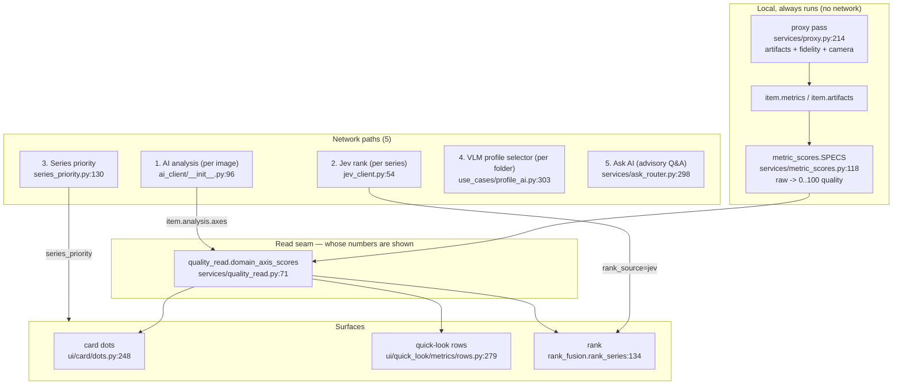
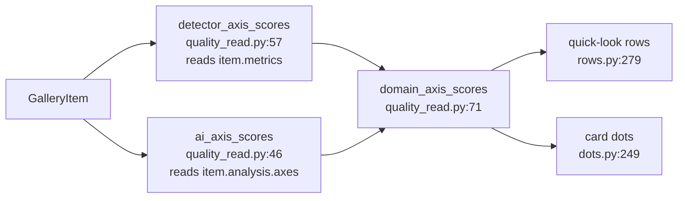
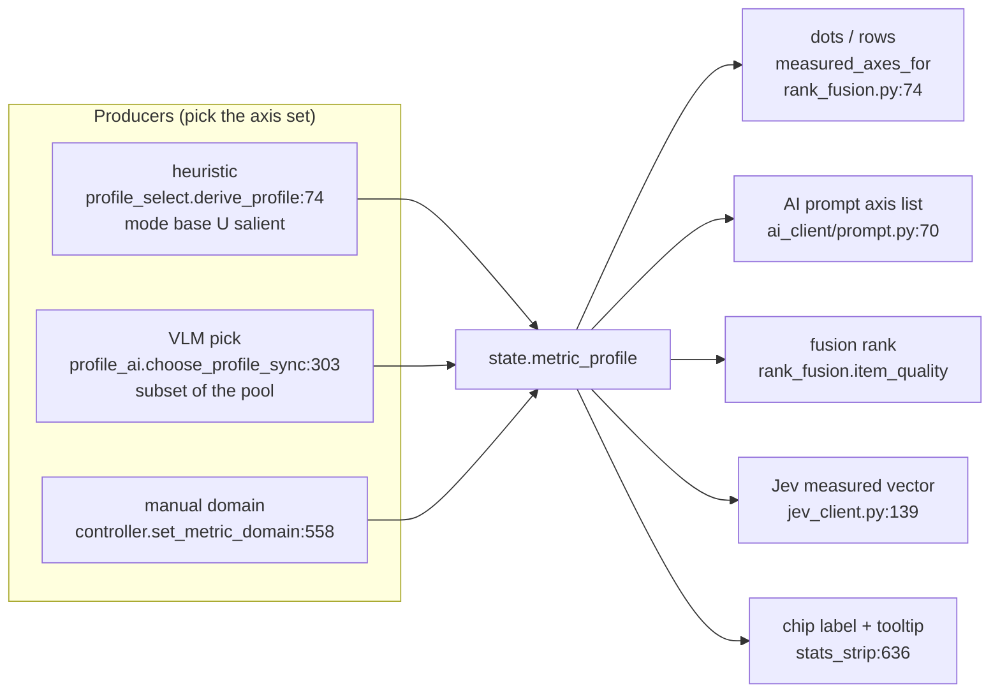

# Image Gallery — how image analysis actually works

Status: as-is map (2026-10-20) · Scope: `src/tabs/image_gallery/` (tab-owned)

Every claim below is a `file:line` in the tree at commit `94f438e2`. Where the
code and the UI text disagree, both are shown — that disagreement is the
point of this document.

Related: [plan-adaptive-metric-profiles-2026-10-17.md](investigations/plan-adaptive-metric-profiles-2026-10-17.md) ·
[README.md](README.md)

---

## 0. The one-paragraph answer

The gallery has **two judgment domains** (Algorithms / AI) and **five distinct
network paths**. They are not one "AI backend": the toolbar switch changes
*whose numbers are shown*, while the AI Settings change *which endpoint and
model the calls go to*, and two of the five paths (Jev rank, series priority)
ignore the user's model entirely and hard-code `typesafe/jev-router`
(`services/jev_client.py:54`). The metric **profile** is a third, orthogonal
axis: it decides *which axes exist*, not who computes them
(`services/rank_fusion.py:74`).

---

## 1. The whole picture

---

## 2. Two judgment domains — the toolbar switch

The switch lives in the toolbar (`ui/toolbar/__init__.py:170`, `_apply_domain`
at `:211`) and is stored on the controller as `_judgment_domain`
(`controller.py:196`) — **not** on `state`, because `state` is replaced on
every folder open (`controller.py:190-196`).

Switching to `ai` does exactly three things
(`use_cases/ai_analysis.py:192` `activate_judgment_domain`):

1. `_run_ai_for_visible()` — analyzes the **visible** images, capped at
   `_AI_VISIBLE_CAP = 12` (`ai_analysis.py:257`, cap at `controller.py:1331`);
2. `_run_jev_ranks()` — one Jev rank per series (`controller.py:1354`);
3. `_run_series_priority()` — cross-series attention hints
   (`controller.py:1527`).

Switching back to `algorithms` re-derives the fusion rank
(`controller.py:990`) and clears the priority hints.

**What the switch does NOT change:** the local detectors keep running and keep
writing `item.metrics` either way. The switch only decides *which* read the
surfaces use.

---

## 3. The read seam — the single place that decides whose numbers are shown

`domain_axis_scores(item, domain=…)` (`services/quality_read.py:71`) is the one
seam: `"ai"` → the VLM's per-axis scorecard, `"algorithms"` → the local
detectors. Every AI/Algorithms-aware surface goes through it, so the domains
cannot drift apart.

Consequence: **in the Algorithms domain the AI contributes nothing to the
numbers.** Not "a little" — nothing. The AI paths in that domain are only
reachable via the explicit Analyze action.

---

## 4. The five network paths

| # | Path | Where | Model | Payload | Result lands in |
|---|---|---|---|---|---|
| 1 | **AI analysis** (per image) | `services/ai_client/__init__.py:96` | `settings.model` | image bytes + axis list | `item.analysis` (scorecard + defects) |
| 2 | **Jev rank** (per series) | `jev_client.py:446` | **hard-coded `typesafe/jev-router`** | measured vector, **no images** | `rank_source="jev"` |
| 3 | **Series priority** | `series_priority.py:130` | **hard-coded `typesafe/jev-router`** | per-series aggregate signals | `state.series_priority` |
| 4 | **VLM profile selector** (per folder) | `use_cases/profile_ai.py:303` | `settings.model` | probe images + salience | `state.metric_profile` (`source="vlm"`) |
| 5 | **Ask AI** (advisory) | `services/ask_router.py:298` | `settings.model` | text or images by question kind | `ask_log` (never mutates rank) |

All five go through **one transport**: `ai_client/transport.py:152`
`call_sync` → `POST <base_url>/chat/completions`, SSE-streamed.

### 4.1 The trap: paths 2 and 3 ignore the user's model

`JEV_MODEL = "typesafe/jev-router"` (`services/jev_client.py:54`) is a
constant. Paths 2 and 3 post it to **the user's `base_url`**
(`controller.py:1582-1591`, `controller.py:1683-1695`).

So the Jev path works only if the configured endpoint happens to host that
model id. On `openai`/`llamacpp`/`custom` the request carries a model id the
endpoint does not know. There is no fallback chain for it (the OpenRouter
fallback chain lives in `ai_client/request.py:134` and is only applied to path
1). A failure degrades visibly — the Algorithms rank is kept and the reason is
surfaced (`jev_client.py:527` `rank_series_jev` → `None` + reason) — but the
user's chosen model was never involved.

**This is the "от ИИ круглый ноль" case the owner saw.** The strip says
`Ранжировано: ИИ (Jev)` (`services/rank_badge.py:61`) while the ranking model
is not the one selected in Settings.

### 4.2 Caching — what is pinned under which key

| Path | Key | File |
|---|---|---|
| AI analysis | model + base_url + mode + profile axes + effort (+ prompt schema) | `ai_cache.py:133` |
| Jev rank | paths + mtimes + canonical payload | `jev_cache.py:60` |
| VLM profile | members + mtimes + mode + model + base_url + effort + pool | `profile_cache.py:90` |
| Ask AI | scope + context + question + backend + model | `controller.py:_ask_cache_key` |

`api_key` is never part of an analysis identity (`ai_cache.py:151`).

---

## 5. The metric profile — a third, orthogonal axis

The profile answers **"which axes exist"**. It never answers "who computed
them" and never carries a value.

Three producers, one consumer seam (`rank_fusion.measured_axes_for`,
`rank_fusion.py:74`). Everything that shows or scores an axis reads the same
set — dots, quick-look rows, the AI prompt, the fusion rank, the Jev vector.
That is why the profile is the right place to hang a "which axes" decision.

**Provenance is one of two values** (`services/metric_profile.py:61`):

- `heuristic` — the deterministic derivation (mode base ∪ salient);
- `vlm` — a model picked a subset of the closed pool.

`vlm` is possible **only** in the AI judgment domain: the selector is gated
(`controller.py:708` — `judgment_domain != "ai"` ⇒ skip) and only when AI is
configured (`:740`). So the chip's `(vlm)` token can never appear while the
shown numbers are detector numbers.

---

## 6. Where the chip lies — three concrete defects

The chip is `ui/stats_strip/__init__.py:154`; the label is built in
`_refresh_profile_chip` (`:636`); the tooltip is `format_profile`
(`services/metric_profile.py:413`).

### 6.1 The label names a domain that is not the active profile

In auto mode the label domain is `domain_for_stats(...)`
(`controller.py:530`, `metric_profile.py:246`) — a weighted-mean-spread
*guess* about the content. The active axis set is `derive_profile`
(`profile_select.py:74`) — mode base ∪ salient. Two different rules.

Measured on a camera folder: `domain_for_stats` → `photo`, while the active
profile was the camera mode base ∪ salient. In the mixed case the label says
*Mixed* (whose own profile is the whole 15-axis pool) while 8 axes are active.

### 6.2 The tooltip's `source=` is overloaded

`source=vlm` / `source=heuristic` describes **the axis set's provenance**. A
user reads it as "the numbers came from the AI". The tooltip is a raw
`axes=… source=… mode=…` debug line, not a user sentence.

### 6.3 A pinned domain can promise axes that cannot be measured

`profile_for_domain(domain, mode=…)` (`metric_profile.py:377`) filters to the
pool **only when a `pool` is passed** — the docstring's "unavailable axes are
dropped". The controller calls it without a pool
(`controller.py:591`), so pinning *Synthetic* in a camera folder yields
`ssim, lpips, dists, halo_delta, chroma_fringe_delta, color_accuracy` — all
`reference`-tagged, i.e. unmeasurable without a source hub. The report then
shows seven gap rows.

---

## 7. Mode, axes, and the closed pool

- **Mode** (folder-level): `fidelity` (a source is set) / `camera` /
  `batch_synthetic` — `services/mode.py:264` `select_mode`.
- **Pool** (closed vocabulary, 16 axes): `metric_profile.py:115`
  `MEASURED_POOL` = the MEASURED registry minus `typicality`.
- **Axis kind**: `models.py:77` `MetricKind` — `MEASURED` (a number),
  `CANDIDATE` (a flag, no number), `JUDGMENT` (plausibility, never a number).
- **Raw → quality**: `metric_scores.py:118` `SPECS`; every axis reads a raw
  key and maps it to 0..100 (higher is always better).
- **Local producers**: `services/proxy.py:214` — artifacts + fidelity metrics
  (+ camera scalars when the mode asks), in one chunked pass
  (`use_cases/proxy_pass.py:33`).
- **Ranking**: `rank_fusion.rank_series:134` — weighted mean of the applicable
  axes, capped by the weakest axis (`RANK_WORST_AXIS_SLACK = 20`,
  `rank_fusion.py:58`).

---

## 8. The honest one-line summary of each surface

| Surface | Reads | Source of the numbers |
|---|---|---|
| Card dots | `dots.py:248-249` | domain read: VLM scorecard (AI) / detectors (Algorithms) |
| Quick-look rows | `rows.py:279,417` | same read; row set = the profile's axes |
| Rank | `rank_fusion.py:134` | same read; weight per axis |
| Rank badge | `rank_badge.py:60-62` | `fusion` / `jev` / `manual` |
| Profile chip | `stats_strip:636` | the axis set + its provenance |
| Ask AI answer | `ask_router.py:298` | text or image payload, advisory only |

---

## 9. Open questions (not fixed by this document)

1. **Should paths 2 and 3 use the user's model?** Today they cannot: Jev is
   a specific router model id. Either the Settings need a separate "ranking
   model" field, or the strip must say *which* model ranked.
2. **Should the chip exist at all?** It is the only entry point to the manual
   domain picker (`stats_strip:720`), but in auto mode its label is a guess
   that can contradict its own tooltip.
3. **`domain_for_stats` is a guess with no consumer other than the label.**
   If the label goes, the whole weighted-spread domain-choice machinery
   (`metric_profile.py:220-286`) goes with it.
4. **Pinned domains need a mode-filtered pool** so they cannot promise
   unmeasurable axes (§6.3).

---

## 10. Engine on by default (W9 read path; P9a default flip)

Status: **on by default** since P9a. The analysis engine's local plan runs inside
the proxy batch (`services/proxy.py`) for every folder, and each batch entry
gains an `"analysis"` key holding that item's per-axis `AxisValue` records —
value, producer, status and reason, from `engine/analysis/contracts.py`.
`use_cases/proxy_pass.py` copies those records onto
`GalleryItem.analysis_records` (transient: never persisted, never sent
anywhere).

**Kill-switch.** `IMGSLI_ANALYSIS_ENGINE=0` disables the engine for the next
batch (no restart needed). The accepted off values are `0`, `false`, `no` and
`off`, case-insensitive and whitespace-stripped; **unset, empty, `1` or any
unrecognized value means on** — a typo can never silently restore the legacy
path. The rule lives in one place, `services/analysis_bridge.engine_enabled()`;
`=1` (the pre-P9a opt-in) keeps working as a no-op affirmation.

**What the engine writes.** With the engine on, the plan's detector pass is the
single computation for the batch:

- `entry["analysis"]` — the per-axis records (provenance for the read path);
- `entry["artifacts"]` / `["fidelity"]` / `["camera"]` — the same legacy stage
  dicts as before, rebuilt from the records' pre-score `raw` values (W12). A
  stage that cannot be rebuilt from its records falls back to its own legacy
  call, so a missing producer costs one stage, never a missing key;
- in `full_res_artifacts` mode (the production default) the records are measured
  over the SAME full-resolution `TiledPixelStore` the tiled catalog reads (W14),
  so the records and the entry's severities are one computation, not two.

`analysis/read.py` prefers those records when an item has any: the record's
value and provenance are what dots/rows/rank receive, regardless of the
judgment domain. A requested axis with no record — or with a record whose status
is `gap`/`error` — stays a gap and is never filled from `item.metrics` or
`item.analysis`. That hard no-fallback rule is the point of the flip: the engine
may disagree with the legacy numbers, and the disagreement is shown rather than
silently repaired.

The default was flipped only after two A/B checks against the legacy path, both
on a real folder with `full_res_artifacts=True`: a headless run produced
identical numbers (8.8s vs 8.8s, cold processes), and a GUI run under a private
Xvfb produced captures with **0 differing pixels** (2560×1392).

What is NOT flipped yet:

- the legacy branch is **still present** — the flag-disabled path runs the
  legacy stage calls unchanged, and `analysis/read.py` keeps its legacy domain
  branch for items without records. Deleting both is the next wave (P9b), not
  this one;
- producers, ranking weights, UI surfaces and persistence are untouched. The
  only user-visible difference is that surfaces now read per-axis records
  instead of whole-dict domain swaps.
