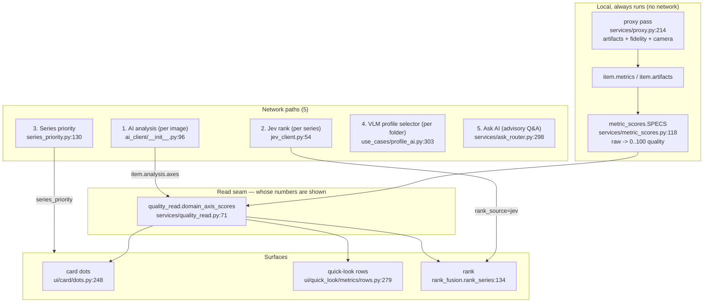
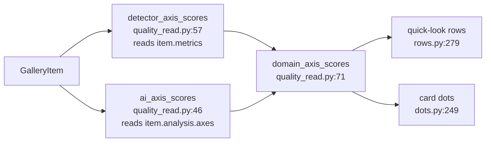
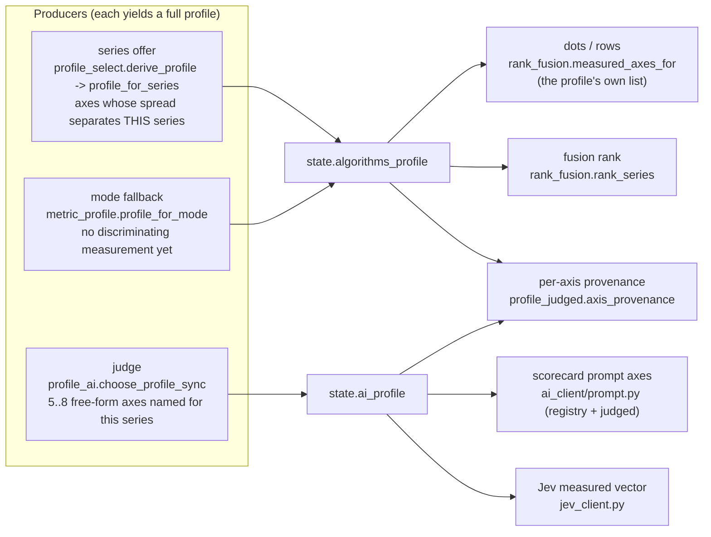

# Image Gallery — how image analysis actually works

Status: as-is map · Scope: `src/tabs/image_gallery/` (tab-owned)

Sections §5–§9 were re-verified against `f6df0b79` (2026-10-22); §1–§4 are the
older survey and §10 is the dated P9b record. Citations name a module and a
symbol: this document was originally pinned to `94f438e2` and `file:NNN` refs rot
within a few commits, so a line number that no longer lands on the named symbol
is stale, not a contradiction.

Related: [plan-adaptive-metric-profiles-2026-10-17.md](investigations/plan-adaptive-metric-profiles-2026-10-17.md) ·
[README.md](README.md)

---

## 0. The one-paragraph answer

The gallery has **two judgment domains** (Algorithms / AI) and **five distinct
network paths**. They are not one "AI backend": the toolbar switch changes
*whose numbers are shown*, while the AI Settings change *which endpoint and
model the calls go to*, and two of the five paths (Jev rank, series priority)
ignore the user's model entirely and hard-code `typesafe/jev-router`
(`services/jev_client.py` `JEV_MODEL`). The metric **profile** is a third,
orthogonal axis: it decides *which axes exist*, not who computes them
(`services/rank_fusion.py` `measured_axes_for` returns the profile's own axis
list — registry half plus the axes the judge named, which
`services/profile_judged.py` reads).

---

## 1. The whole picture

---

## 2. Two judgment domains — the toolbar switch

The switch lives in the toolbar (`ui/toolbar/__init__.py:170`, `_apply_domain`
at `:211`) and is stored on the controller as `_judgment_domain`
(`controller.py:196`) — **not** on `state`, because `state` is replaced on
every folder open (`controller.py:190-196`).

Switching to `ai` does exactly three things
(`use_cases/ai_analysis.py:192` `activate_judgment_domain`):

1. `_run_ai_for_visible()` — analyzes the **visible** images, capped at
   `_AI_VISIBLE_CAP = 12` (`ai_analysis.py:257`, cap at `controller.py:1331`);
2. `_run_jev_ranks()` — one Jev rank per series (`controller.py:1354`);
3. `_run_series_priority()` — cross-series attention hints
   (`controller.py:1527`).

Switching back to `algorithms` re-derives the fusion rank
(`controller.py:990`) and clears the priority hints.

**What the switch does NOT change:** the local detectors keep running and keep
writing `item.metrics` either way. The switch only decides *which* read the
surfaces use.

---

## 3. The read seam — the single place that decides whose numbers are shown

`domain_axis_scores(item, domain=…)` (`services/quality_read.py:71`) is the one
seam: `"ai"` → the VLM's per-axis scorecard, `"algorithms"` → the local
detectors. Every AI/Algorithms-aware surface goes through it, so the domains
cannot drift apart.

Consequence: **in the Algorithms domain the AI contributes nothing to the
numbers.** Not "a little" — nothing. The AI paths in that domain are only
reachable via the explicit Analyze action.

---

## 4. The five network paths

| # | Path | Where | Model | Payload | Result lands in |
|---|---|---|---|---|---|
| 1 | **AI analysis** (per image) | `services/ai_client/__init__.py:96` | `settings.model` | image bytes + axis list | `item.analysis` (scorecard + defects) |
| 2 | **Jev rank** (per series) | `jev_client.py:446` | **hard-coded `typesafe/jev-router`** | measured vector, **no images** | `rank_source="jev"` |
| 3 | **Series priority** | `series_priority.py:130` | **hard-coded `typesafe/jev-router`** | per-series aggregate signals | `state.series_priority` |
| 4 | **VLM profile selector** (per folder) | `use_cases/profile_ai.py:303` | `settings.model` | probe images + salience | `state.ai_profile` (`source="vlm"`) |
| 5 | **Ask AI** (advisory) | `services/ask_router.py:298` | `settings.model` | text or images by question kind | `ask_log` (never mutates rank) |

All five go through **one transport**: `ai_client/transport.py:152`
`call_sync` → `POST <base_url>/chat/completions`, SSE-streamed.

### 4.1 The trap: paths 2 and 3 ignore the user's model

`JEV_MODEL = "typesafe/jev-router"` (`services/jev_client.py:54`) is a
constant. Paths 2 and 3 post it to **the user's `base_url`**
(`controller.py:1582-1591`, `controller.py:1683-1695`).

So the Jev path works only if the configured endpoint happens to host that
model id. On `openai`/`llamacpp`/`custom` the request carries a model id the
endpoint does not know. There is no fallback chain for it (the OpenRouter
fallback chain lives in `ai_client/request.py:134` and is only applied to path
1). A failure degrades visibly — the Algorithms rank is kept and the reason is
surfaced (`jev_client.py:527` `rank_series_jev` → `None` + reason) — but the
user's chosen model was never involved.

**This is the "от ИИ круглый ноль" case the owner saw.** The strip says
`Ранжировано: ИИ (Jev)` (`services/rank_badge.py:61`) while the ranking model
is not the one selected in Settings.

### 4.2 Caching — what is pinned under which key

| Path | Key | File |
|---|---|---|
| AI analysis | model + base_url + mode + profile axes + effort (+ prompt schema) | `ai_cache.py:133` |
| Jev rank | paths + mtimes + canonical payload | `jev_cache.py:60` |
| VLM profile | members + mtimes + mode + model + base_url + effort + pool | `profile_cache.py:90` |
| Ask AI | scope + context + question + backend + model | `controller.py:_ask_cache_key` |

`api_key` is never part of an analysis identity (`ai_cache.py:151`).

---

## 5. The metric profile — registry half + judge half

The profile answers **"which axes exist"**. It never answers "who computed them"
and never carries a value; the numbers travel per item, the profile only names
the axes and their provenance.

Two backends, two slots (backend-isolation invariant I1): the local derivation
writes `state.algorithms_profile`, the judge writes `state.ai_profile`, and every
consumer reads its own slot. Since ADR 009 wave A2 the slot is WRITTEN and READ
by the owning adapter — `backends.algorithms` / `backends.ai` (`install` /
`load_profile`) — and `metric_profile.profile_for_domain` is a deprecated
one-line delegate to that adapter (it survives into wave A4, which rewrites the
remaining by-domain lookups in the controller/use cases). A foreign-tagged
profile is a loud `ForeignProfileError`, never a silent cross-read; an
AXIS-LESS profile is `NoProfileYet` (`make_profile`/`install`/`measure`/`rank`),
because "no axis set yet" is the absence of a profile, not a profile to repair.

**Wave A3 — each backend reads only its own artifacts.** The two operations that
read numbers live in their own modules and see one instrument each:
`backends/algorithms/measure.py` + `rank.py` (local engine records /
`item.metrics`, the profile's REGISTRY half only, `rank_fusion.rank_series(axes=…)`)
and `backends/ai/measure.py` + `rank.py` (the scorecard over registry ids AND
judged names, `jev_client.rank_series_jev`). Three consequences worth naming:

- **the mode-mapping fallback is gone from the core**: `rank_fusion
  .measured_axes_for(profile=…)` answers the profile's OWN axis list or raises
  `NoProfileYet`; the mode mapping is reached only without a profile, through the
  backend that owns it (`backends.algorithms` `axes_for_mode`). An EMPTY AI
  profile used to fall through to the detector axes, so the scorecard prompt, the
  request's echo filter, the Jev vector, the card dots and the pairwise payload
  all silently asked/measured the LOCAL axis set (each chain — action context →
  prompt, request echo filter, Jev vector, card dots, pairwise payload,
  series priority — is pinned in
  `src/tabs/image_gallery/tests/isolation/test_ai_profile_fallback_dies.py`);
- **pairwise is a declared capability**, not a shared feature: the request goes
  through `backends.composition.pairwise_backend(id)` →
  `require_capability(descriptor, PAIRWISE_CAPABILITY)`; the Algorithms adapter
  never declared it, so asking it (or handing its rank a `pairwise_order`) is
  `CapabilityNotDeclared`. Its rank is applied by the AI adapter
  (`backends/ai/rank.py`, the same leading-ranks rule as `rank_series`);
- **the cross-series priority payload is the judge's own number**:
  `services/series_priority` takes the AI profile as an argument and aggregates
  `backends.ai.measure.series_quality` — it used to call
  `rank_fusion.item_quality(mode=…)` with no profile, i.e. the LOCAL fusion
  aggregate, and sent detector numbers to the AI endpoint. Without a profile the
  pass reports `PRIORITY_REASON_NO_PROFILE` and spends nothing.

`source` is one of three values (`PROFILE_SOURCES` in
`services/metric_profile.py`):

- `series` — the default producer: the axes whose measured spread in this folder
  separates the images (`profile_for_series`, fed by
  `services/axis_spread.py`);
- `vlm` — the judge named the axes (`use_cases/profile_ai.py`, pinned per folder
  generation in `services/profile_cache.py`);
- `heuristic` — the mode mapping (`profile_for_mode`), used only while there is
  no discriminating measurement; `profile_source_label` traces it as a fallback.

**Two halves, two vocabularies** (`services/metric_profile.py` docstring,
`MetricProfile.axis_ids` vs `axis_entries`):

- **registry half** — `axis_ids`: ids from the closed pool (`MEASURED_POOL`),
  i.e. axes a local detector can produce. `rank_fusion.measured_axes_for` answers
  with this half for a local profile, so local rows, the fusion mean and the
  local rank keep ONE vocabulary (and `backends.algorithms.measure/rank` pass
  exactly this half, so a judge entry that reached a local profile cannot move
  the local order).
- **judge half** — `axis_entries`: `models.AiAxisProposal` records (name +
  definition + 0–100 scale + direction) the model named for this series. No
  local producer exists and none is required: the scorecard prompt asks for them
  by name (`ai_client/prompt.py` reads `judged_axis_entries`) and the judge
  measures them. `services/profile_judged.normalized_entries` is the only way an
  entry reaches a profile (a registry id of the same profile is not a second
  axis; a name with no definition is dropped, with a refusal code from
  `services/axis_choice.parse_axis_choices`).

**Provenance of a measurement is one of two tokens**
(`services/profile_judged.py`: `PROVENANCE_LOCAL` / `PROVENANCE_JUDGE`), and it
answers **who measured the number**, not who *could* have:

- `measured-locally` — the number came from a local detector;
- `measured-by-judge` — the number came from the model's scorecard, **even on a
  registry axis** (a judge that picks `sharpness` from the pool is the normal
  case, `ai_client/parse` routes that pick into `profile.axis_ids`) — or the
  axis is one the judge named, or a registry axis this context has no local
  producer for.

`analysis.read.read_axes` stamps the token from the record's own `producer`, so
the AI domain's dots/rows are the judge's instrument (accent) and the Algorithms
domain's are a detector band. `axis_provenance(axis, mode=…, profile=…)` without
a producer answers the static "who can measure it here" question (an axis
description, not a read); it returns `""` (no claim) when it cannot decide —
never a guess. With no profile at all the AI domain has no axis set of its own:
`rank_fusion.measured_axes_for(profile=None, domain="ai")` raises
`NoProfileYet` instead of falling back to the local mode mapping.

Profile choice is possible **only** in the AI judgment domain: the Algorithms
domain owns the derivation and records the refusal as
`GalleryState.profile_reject_reason = "domain-algorithms"`
(`PROFILE_REJECT_DOMAIN`); every other failure has its own code there
(`calls-built`, `stale-generation`, `hollow-answer`). So a judge-named axis can
never appear while the shown numbers are detector numbers.

**Wave A4 — the caches belong to the adapters, and so does the reset.** The
reset is no longer a list of store names in `use_cases/cache_reset.py`; it is one
registry iteration (`for backend in registry.iter_backends(): backend.reset()`),
and each adapter names what it drops in its own `reset.py`
(`backends/algorithms/reset.py`, `backends/ai/reset.py`):

| Backend (`cache_namespace`) | Owned stores it clears |
|---|---|
| `algorithms` | `services.metrics_cache` (the local Stage-2 records) |
| `ai` | `services.ai_cache` (scorecards), `services.profile_cache` (VLM profile pins), `services.jev_cache` (Jev rank pins), `services.vlm_cache` (tie-break / brief files), `use_cases.pairwise_rank.DEFAULT_CACHE` (A/B verdicts), the Ask-AI answer caches issued by `AIBackend.new_ask_cache` |

Every cache module declares `CACHE_NAMESPACE`, and `backends.reset
.require_namespace` refuses an adapter clearing a store of another namespace
(`BackendMismatch`) — the pattern a registry cannot see, because the registry only
catches two backends claiming the same one (`CacheNamespaceCollision`). What the
use case keeps is the engine-side half: per-item measured state, the proxy decode
cache, the in-memory `state.tie_breaks` / `state.series_priority` projections and
their header marker, the profile-selector generation markers, the stored profile
slots and the Stage-2 fingerprint.

**Generations close the write window the barrier cannot see.** The barrier
(`use_cases/reset_barrier`) bumps the owner's two epoch tokens and every *landing*
path compares them — but three writes never land through an item: they go straight
from a worker thread into a store (`services.jev_client._pin`, the profile pin in
`use_cases.profile_ai`, `store.put` in `use_cases.pairwise_rank`). Each adapter now
holds a monotonic **work generation** and the reset advances it *first*; a worker
snapshots `adapter.lease()` when its pass starts and the pin asks
`generation_is_current(lease, operation=…)` immediately before the write. The
refusal is the owning adapter's and it is typed: `BackendMismatch` for the other
backend's lease, `NoProfileYet` (carrying the dropped generation) for an older one
— after a reset there is no profile of that generation for the result to belong
to. A reset that cleared first and bumped afterwards would let the lease compare
current again, which is why the bump is the first statement of both `reset`
modules.

The Ask-AI answers are the concrete bug this closes: they lived on the controller
(`_ask_cache`, keyed by scope + question + backend + model) and no clear knew
about them, so a paid answer outlived every reset. The AI adapter now issues the
cache (`new_ask_cache(owner)`, a weak per-owner binding) and empties every bound
one in its `reset`.

---

## 6. Removed: the metric-profile chip (2026-10-20)

The stats-strip chip, the domain flyout it opened, `GalleryController.set_metric_domain`,
`_metric_domain` (+ its `state.metric_domain` mirror), the stats-driven domain
guess `domain_for_stats` and `profile_for_domain`'s pinning use were deleted with
the manual domain pin (owner decision recorded in
`investigations/plan-gallery-analysis-engine-2026-10-20.md` §Product decision).

Do not re-add a profile label or a domain pin here: per-axis provenance (§5)
replaces the chip's one-line claim, and the measured axes are already visible as
rows/dots. The three defects that motivated the deletion — a label naming a
domain that was not the active profile, an overloaded `source=` token in the
tooltip, a pinned domain promising axes that cannot be measured — are recorded
in that plan, not re-litigated here.

---

## 7. Mode, axes, and the closed pool

- **Mode** (folder-level): `fidelity` (a source is set) / `camera` /
  `batch_synthetic` — `services/mode.py` `select_mode`.
- **Pool** (closed vocabulary): `metric_profile.MEASURED_POOL`, materialized
  from `pool_axis_ids()` = the MEASURED registry minus `EXCLUDED_AXES`. It is
  the **registry half's** vocabulary, not a limit on the judge: an axis the
  judge names lives in `MetricProfile.axis_entries` and is not in the pool and
  does not have to be (plan P7-A).
- **Axis kind**: `models.py` `MetricKind` — `MEASURED` (a number),
  `CANDIDATE` (a flag, no number), `JUDGMENT` (plausibility, never a number).
- **Raw → quality**: `metric_scores.py` `SPECS`; every axis reads a raw
  key and maps it to 0..100 (higher is always better).
- **Local producers**: `services/proxy.py` — artifacts + fidelity metrics
  (+ camera scalars when the mode asks), in one chunked pass
  (`use_cases/proxy_pass.py`).
- **Ranking**: `rank_fusion.rank_series` — weighted mean of the applicable
  axes, capped by the weakest axis (`RANK_WORST_AXIS_SLACK = 20`,
  `services/rank_fusion.py`).

---

## 8. The honest one-line summary of each surface

| Surface | Reads | Source of the numbers |
|---|---|---|
| Card dots | `dots.py` | domain read: VLM scorecard (AI) / detectors (Algorithms) |
| Quick-look rows | `rows.py` | same read; row set = the profile's axes |
| Rank | `rank_fusion.rank_series` | same read; weight per axis |
| Rank badge | `rank_badge.py` | `fusion` / `jev` / `manual` |
| Axis provenance | `profile_judged.axis_provenance` | `measured-locally` / `measured-by-judge` per axis — the instrument that WROTE the number |
| Ask AI answer | `ask_router.py` | text or image payload, advisory only |

---

## 9. Open questions (not fixed by this document)

1. **Should paths 2 and 3 use the user's model?** Today they cannot: Jev is
   a specific router model id (`JEV_MODEL`). Either the Settings need a separate
   "ranking" model field, or the strip must say *which* model ranked.
2. **Do judge-named axes need a stability rule?** They are free-form by owner
   decision (5..8, each with a definition); `services/profile_cache.py` keys a
   selection on the sorted member paths + mtimes + mode + model + base_url +
   effort + pool. Whether a series that gains a member should keep its earlier
   axis set, or accept a fresh one, is not decided.

---

## 10. The engine is the only path (W9 read path; P9a flip; P9b deletion)

Status: **the only path** since P9b. The analysis engine's local plan runs inside
the proxy batch (`services/proxy.py`) for every folder, and each batch entry
gains an `"analysis"` key holding that item's per-axis `AxisValue` records —
value, producer, status and reason, from `engine/analysis/contracts.py`.
`use_cases/proxy_pass.py` copies those records onto
`GalleryItem.analysis_records` (transient: never persisted, never sent
anywhere).

**No kill-switch.** P9b deleted the env switch, its off-value list and the single
function that read it (`services/analysis_bridge.py`): the engine has no "run the
engine first, else the legacy detectors" branch, and a flag left in a shell
profile changes nothing. There is one detector pass per item, and the legacy
Stage-2 functions are not a second path — `tests/` still calls them as an oracle
(`_legacy_oracle`), production code does not.

**What the engine writes.** The plan's detector pass is the single computation
for the batch:

- `entry["analysis"]` — the per-axis records (provenance for the read path);
- `entry["artifacts"]` / `["fidelity"]` / `["camera"]` — the stage dicts the
  report and the card still consume, rebuilt from the records' pre-score `raw`
  values (W12), axis by axis. An axis no producer answers stays out of the dict
  — a gap, not a borrowed number. Every key of the legacy camera dict has a
  producer today: `camera_scalars` answers the `brisque` raw that
  `measure_camera_from_image` appends from `quality_models.nr_metrics` (and
  gaps it, with a reason, when the content gate or the backend says no);
- in `full_res_artifacts` mode (the production default) the records are measured
  over the SAME full-resolution `TiledPixelStore` the tiled catalog reads (W14),
  so the records and the entry's severities are one computation, not two.

**When a producer fails.** The stage dict is simply absent from the entry and one
`warning` names the stage and the producer (with the axes and the producer's own
reason). Nothing is measured a second time, so the reader sees the gap rather
than a legacy number that disagrees with the records behind it:

| Stage | Producer fails | What the entry carries | What the reader sees |
|---|---|---|---|
| camera | `camera_scalars` raises | no `camera` dict | camera axes as `error` records, then gaps — never legacy scalars |
| fidelity | `fidelity_reference` raises | no `fidelity` dict | fidelity axes as `error` records — never a re-run pair |
| artifacts | `artifact_catalog` raises | the **recomputed catalog** | the real severities (see below) |

**The one exception: the artifact catalog.** A missing artifact entry renders as
`clean` in the UI (`quality_read.domain_artifact_severity` defaults to clean), so
a producer failure without a fallback would look like "nothing wrong" instead of
a failure. P9b therefore keeps exactly that fallback: `services/proxy.py`
recomputes the catalog — the tiled call in `full_res_artifacts` mode, else
`artifacts.analyze_images` over the bounded proxy — and still logs the warning,
so the substitution is visible in the log even though the entry looks complete.

`analysis/read.py` prefers the records when an item has any: the record's value
and provenance are what dots/rows/rank receive, regardless of the judgment
domain. A requested axis with no record — or with a record whose status is
`gap`/`error` — stays a gap and is never filled from `item.metrics` or
`item.analysis`. That hard no-fallback rule is the point: the engine may disagree
with the legacy numbers, and the disagreement is shown rather than silently
repaired.

The P9a default flip was validated before P9b removed the branch, by two A/B
checks against the legacy path on a real folder with `full_res_artifacts=True`: a
headless run produced identical numbers (8.8s vs 8.8s, cold processes), and a GUI
run under a private Xvfb produced captures with **0 differing pixels**
(2560×1392). P9b additionally keeps the rebuilt entries byte-identical to the
legacy dictionaries on those fixtures (`test_entry_equals_the_legacy_stage_dicts`).

What P9b did NOT change: producers, ranking weights, UI surfaces and
persistence. The only user-visible difference is that surfaces read per-axis
records instead of whole-dict domain swaps, and a broken producer now shows a gap
where it used to show a legacy number.
