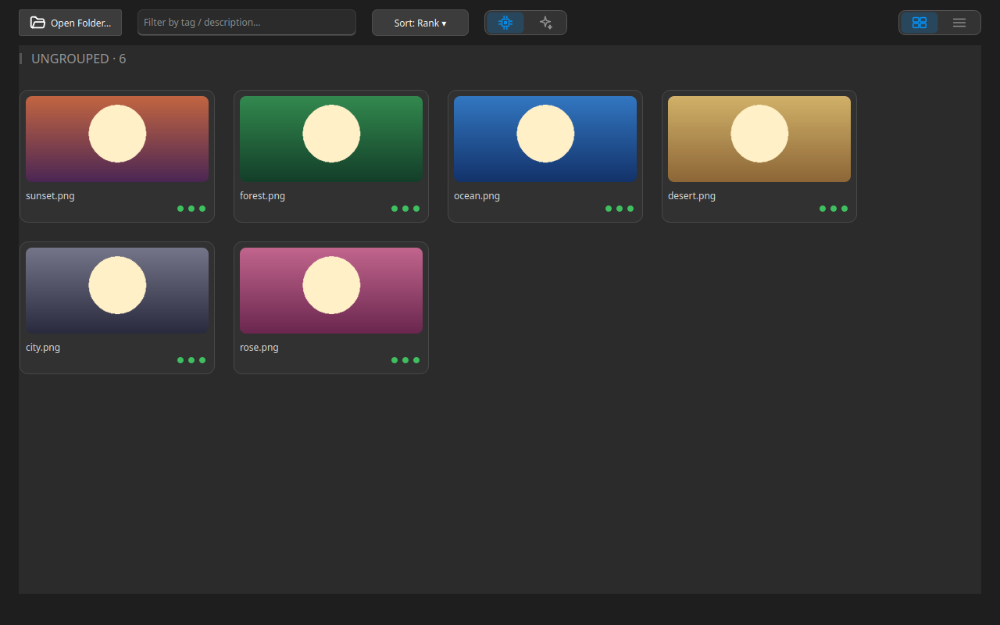

## Gallery Overview

**Image Gallery** groups a folder of similar shots into series, so you can keep the best and compare the rest.

### Open a folder {#open-folder}

- **Open Folder…** — opens the folder picker. While the tab is empty, dragging files over it shows a dashed drop zone with **Pick a folder to see images here.**
- **Drag and drop** — dropped files join the images already in the tab; a single file opens on its own, without scanning its parent folder.
- **New Image Gallery Session** — opens another gallery session from **Find Action** (`Ctrl+Shift+P`).
- **Large AI batch** — while **AI** is on, dropping more than 35 images at once shows a warning before they are sent, because a big batch can mean a big API bill. Pick **Confirm**, **Confirm and don't ask again**, or **Cancel**.

### Series {#series}

After a folder loads, the gallery groups similar images into series — one section per group.

- **Series** — two or more matching images form a series; images with no match appear together under the **UNGROUPED** header.
- **Re-cluster series** — groups the images again; manual pins are kept.
- **Reset manual series** — clears the pins and groups from scratch.

### Grid, sort, and filter {#grid-sort-filter}

- **View** — switches between **Grid** and **List**.
- **Sort by** — orders images by **Rank**, **Name**, **Date**, or **AI quality**; unscored images sink to the end.
- **Filter by tag / description…** — narrows the grid to matching images; the selection is not affected.

:::figure{side=block width=100%}

**Grid** view: the **Open Folder…** toolbar above a grid of cards, each card carrying a file name and one quality dot per measured metric.
:::

### Stats strip and compare {#stats-and-compare}

The strip above the grid reports how many images, series, and redundant images the folder holds.

- **Compare finalists** — sends the best image of each series, plus every image outside a series, to Image Compare (up to 12 files).
- **Quick Look** — a click on a card opens the image's quality readings; `Ctrl+click` selects several cards instead.

### Next topics {#next-topics}

- [Triage and Review](help://workspace.image_gallery.triage) — keep the best, reject the rest, and move rejects out of the folder.
- [Quality Metrics](help://workspace.image_gallery.quality) — what the scores mean and where they appear.
- [Ranking: Algorithms and AI](help://workspace.image_gallery.ranking) — who ranks a series and how to read the rank.
- [Ask AI](help://workspace.image_gallery.ask_ai) — ask questions about a selection or a whole series.
