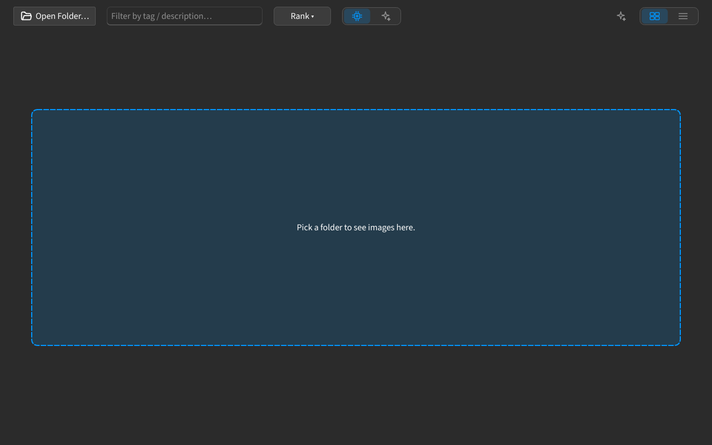

## Visão geral da Galeria

A **Galeria** agrupa em séries uma pasta de fotos parecidas, para manter as melhores e comparar as demais.

### Abrir uma pasta {#open-folder}

- **Abrir pasta…** — abre o seletor de pastas. Enquanto a aba está vazia, arrastar arquivos sobre ela mostra uma zona tracejada com **Escolha uma pasta para ver as imagens aqui.**
- **Arrastar e soltar** — os arquivos soltos entram nas imagens já presentes na aba; um único arquivo abre isolado, sem varrer a pasta onde está.
- **Nova sessão Image Gallery** — abre outra sessão de galeria em **Localizar ação** (`Ctrl+Shift+P`).
- **Lote grande de IA** — com **IA** ligado, soltar mais de 35 imagens de uma vez mostra um aviso antes do envio, pois um lote grande pode gerar um custo alto. Escolha **Confirmar**, **Confirmar e não perguntar novamente** ou **Cancelar**.

:::figure{side=block width=100%}

Galeria vazia: a zona tracejada pede uma pasta; a grade fica vazia até uma ser aberta.
:::

### Séries {#series}

Depois que uma pasta carrega, a galeria agrupa imagens parecidas em séries — uma seção por grupo.

- **Séries** — duas ou mais imagens correspondentes formam uma série; imagens sem correspondência aparecem juntas sob o cabeçalho **SEM GRUPO**.
- **Reagrupar séries** — agrupa as imagens novamente; as fixações manuais são mantidas.
- **Redefinir séries manuais** — limpa as fixações e agrupa do zero.

### Grade, ordenação e filtro {#grid-sort-filter}

- **Visualizar** — alterna entre **Grade** e **Lista**.
- **Ordenar por** — ordena as imagens por **Classificação**, **Nome**, **Data** ou **Qualidade da IA**; imagens sem pontuação vão para o fim.
- **Filtrar por tag / descrição…** — restringe a grade às imagens correspondentes; a seleção não é afetada.

:::figure{side=block width=100%}

Visão **Grade**: a barra com **Abrir pasta…** acima de uma grade de cartões, cada cartão com o nome do arquivo e um ponto de qualidade por métrica medida.
:::

### Faixa de estatísticas e comparação {#stats-and-compare}

A faixa acima da grade informa quantas imagens, séries e imagens redundantes a pasta contém.

- **Comparar finalistas** — envia a melhor imagem de cada série, além de toda imagem fora de uma série, para Comparar imagens (até 12 arquivos).
- **Visualização rápida** — um clique em um cartão abre as leituras de qualidade da imagem; `Ctrl+clique` seleciona vários cartões.

### Próximos tópicos {#next-topics}

- [Triagem e revisão](help://workspace.image_gallery.triage) — mantenha as melhores, rejeite as demais e mova as rejeitadas para fora da pasta.
- [Métricas de qualidade](help://workspace.image_gallery.quality) — o que as pontuações significam e onde aparecem.
- [Classificação: Algoritmos e IA](help://workspace.image_gallery.ranking) — quem classifica uma série e como ler a classificação.
- [Perguntar à IA](help://workspace.image_gallery.ask_ai) — faça perguntas sobre uma seleção ou uma série inteira.
