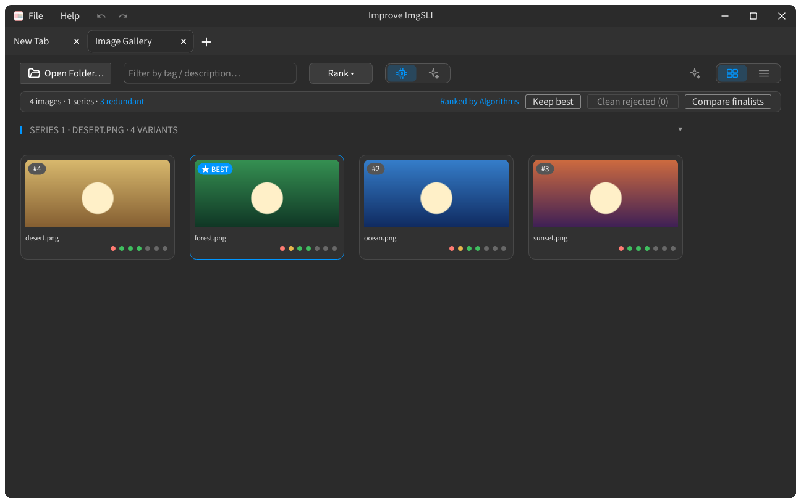

## Triagem e revisão

A triagem mantém um vencedor por série e pode mover as imagens rejeitadas para fora da pasta.

### Manter a melhor da série {#keep-best}

- **Manter o melhor** — mantém a melhor imagem de cada série e rejeita as demais.
- A vencedora permanece no ranking 1 de sua série; os cartões rejeitados ficam esmaecidos e ganham um tachado.
- **Mostrar tudo** — limpa todas as marcações de rejeição e traz as imagens de volta.

:::figure{side=block width=100%}

A faixa de estatísticas (**imagens · séries · redundantes**) com **Manter o melhor**, **Limpar rejeitados** e **Comparar finalistas**, cabeçalhos de série e cartões rejeitados esmaecidos.
:::

### Ações de triagem {#make-best-reject}

- **Marcar como melhor** — marca a imagem selecionada como vencedora de sua série.
- **Rejeitar** — alterna a marcação de rejeição nas imagens selecionadas; quando todas estão rejeitadas, o rótulo muda para **Reverter rejeição**.
- **Remover da visualização** — `Space` ou `Delete` retira os cartões selecionados da grade; os arquivos permanecem no disco.
- **Redefinir cache de métricas** — descarta as métricas medidas e executa a passagem novamente, então os cartões são medidos do zero.

### Revisão de limpeza {#clean-review}

- **Limpar rejeitados** — move as imagens rejeitadas para a pasta `_rejected/` ao lado delas. Uma prévia da movimentação aparece primeiro, e os arquivos permanecem no disco.
- **Desfazer** — no aviso que segue a movimentação, restaura os arquivos movidos para a pasta.

### Executar a triagem novamente {#run-triage}

**Executar triagem** reabre a pasta atual e agrupa as imagens novamente do zero.

### Definir como origem {#set-as-source}

**Definir como origem** na **Visualização rápida**, na **Localizar ação** e no menu do cartão escolhe a imagem usada como referência de comparação. A referência é sempre escolhida manualmente. Veja [Métricas de qualidade](help://workspace.image_gallery.quality#reference-source).
