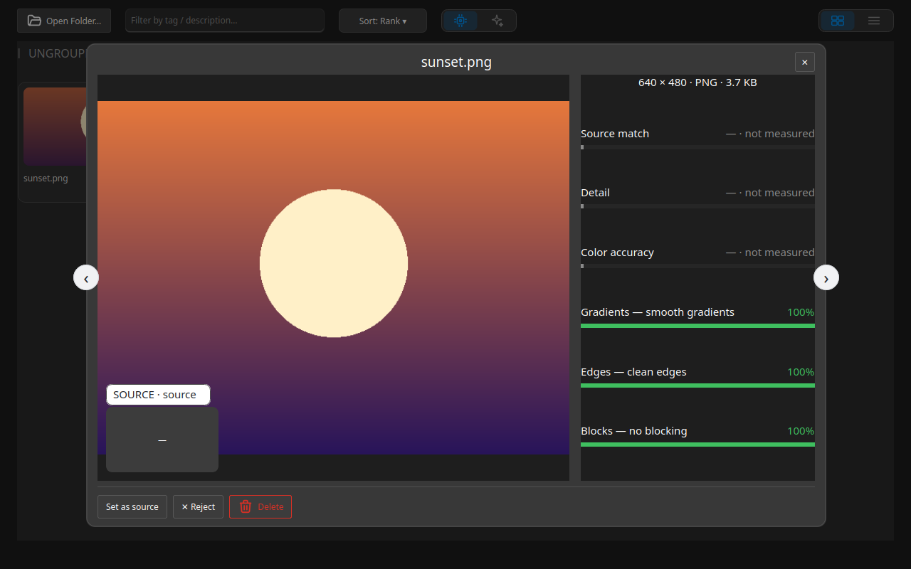

## Метрики качества

Каждое изображение получает оценку от 0 до 100, и чем выше оценка, тем лучше. Оценка обобщает несколько измерений изображения, поэтому высокая оценка означает, что изображение хорошо сразу по всем им.

### Измеряемые метрики {#measured-metrics}

Оценка объединяет резкость, экспозицию, шум и цвет, а при заданном источнике — ещё и то, насколько изображение совпадает с ним. **Быстрый просмотр** показывает каждое измерение в процентах; измерение, которое не удалось получить, показывается прочерком, а не нулём. В домене **ИИ** эти показатели — собственный анализ ИИ; в домене **Алгоритмов** — измерения приложения.

### Где показываются оценки {#where-scores}

- **Быстрый просмотр** — открывает панель со строкой на каждое измерение и его процентом.
- **Лента быстрого просмотра** — ←/→ (или круги ‹/›) двигают фокус по ленте, а Enter показывает выбранное изображение: серию можно просмотреть, не переключаясь на каждое нажатие. ↓ переводит фокус на кнопки панели (**Сделать источником** / **Отклонить** / **Удалить**), ←/→ выбирают нужную, Enter нажимает её; ↑ возвращает на ленту.
- **Точки на карточке** — по одной точке на каждую метрику, измеряемую в текущем режиме; точка становится зелёной (70 %+), жёлтой (40–69 %) или красной (ниже 40 %) по мере ухудшения показателя. Наведите курсор на точку, чтобы увидеть название метрики и процент.
- **Качество ИИ** — значение **Сортировка**, которое упорядочивает изображения в первую очередь по оценке ИИ; оно действует, только пока в панели инструментов включён переключатель **ИИ**, а изображения без оценки опускаются в конец.

:::figure{side=block width=100%}

**Быстрый просмотр**: изображение слева, а справа — сведения о файле и по строке на каждое измерение с процентом или прочерком.
:::

### Режимы {#modes}

Галерея выбирает режим для папки, и режим решает, какие метрики показывают точки на карточке.

Когда изображение задано источником, оценка дополнительно измеряет, насколько каждое изображение совпадает с ним; источник всегда выбирается вручную, никогда автоматически. Без источника галерея считает папку либо фотографиями с камеры, либо синтетическим набором.

### Источник для сравнения {#reference-source}

**Источник** — изображение, выбранное как эталон для сравнения.

**Сделать источником** задаёт этот эталон; анализ затем запускается заново относительно него, и оценки следуют за новым эталоном при следующем проходе.
