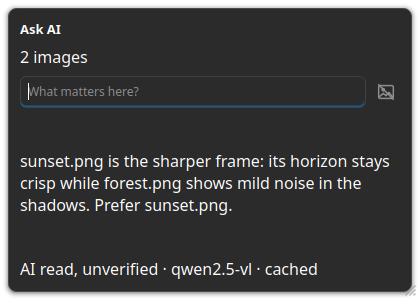

## 询问 AI

**询问 AI** 可以就单张卡片、当前选中项或整个系列提问。回答仅供参考，并且始终带有 **AI 解读，未经核实** 标记。

### 就选中项提问 {#ask-selection}

- **AI…** — 为该卡片或当前选中项打开 **询问 AI**。
- **这里有什么重点？** — 默认问题；它让模型概括收到的图像。
- **AI 解读，未经核实** — 回答上的标记；它把回答标为未经核实。

:::figure{side=block width=420}

**询问 AI** 面板：问题输入框、回答，以及 **AI 解读，未经核实** 标记。
:::

### 就系列提问 {#ask-series}

系列的标题菜单会一次对系列中的每个成员提问。问题会携带测量到的读数——见 [质量指标](help://workspace.image_gallery.quality)。

### 历史与侧边栏 {#history-sidebar}

- **历史** — 面板列出问答记录中已回答的问题，最新在末尾；每条记录显示问题及其回答。
- 选择一条记录会再次显示已保存的回答——不会发起新的 AI 请求。
- 工具栏上的 **AI** 开关显示或隐藏 **询问 AI** 侧边栏：同一个提问界面，停靠在网格旁边而不是弹出窗口。**✕** 关闭它；方向键可以到达开关和每一行历史记录。

### 设置与限制 {#setup}

- **图库 — AI** — 询问 AI 背后的设置分区；提问需要 **启用 AI 图像分析**、**API 密钥** 和 **模型名称**。在 [设置](help://platform.settings#image-gallery-ai) 中配置。三者缺一，应用会显示 **请先在设置中配置 AI API 密钥。**
- 模型处理期间，面板会显示 **思考中…**；请求失败会报告 **AI 无法回答。**
- 回答绝不会改变排名、选中项或任何已存储状态。
- 相同的问题会复用缓存的回答；更换模型或图像变化会再次询问模型。

### 一次 AI 裁判运行的成本 {#cost}

同一个 **图库 — AI** 分区还负责整组分析的这两个限制，见 [设置](help://platform.settings#image-gallery-ai)：

- **AI 裁判并行请求数** — AI 裁判同一时刻最多能同时发出多少个请求；每一条并行通道都是同一时刻又发给提供商的一个请求。
- **AI 裁判每次运行的调用上限** — 一次裁判运行最多能发出多少次调用；**不限** 表示这次运行不设上限。一次运行每张卡片最多发出 k 次调用，k 就是 **每张卡片的运行次数**，所以 10 张卡片、每张 3 次运行，最多花费 30 次调用。
- **用两两比较细化接近的结果** — 用「A 还是 B」的问题为逐项评分最好的几张图排序，而不是增加每张卡片的运行次数；一次运行最多花费 N × (N−1) 次调用（默认 N = 5，即 10 对、最多 20 次调用），如果该组内的逐项评分差距已超过“接近”阈值，则整段直接跳过。
