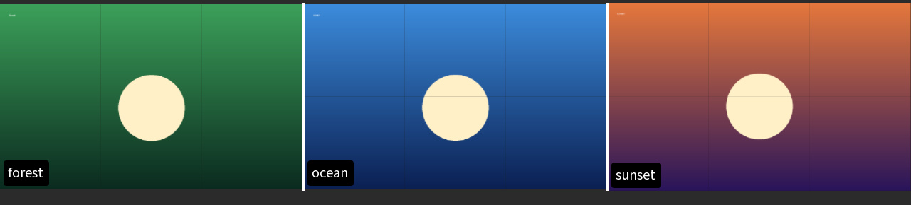

## Обзор мультисравнения

Сессия **Мультисравнение** сравнивает сразу несколько изображений: они раскладываются по слотам сетки, а приближение и панорама применяются ко всей сетке сразу. Выбирайте её, когда нужно сравнить три изображения и больше.

### Как начать {#open-session}

1. Откройте [Выбор сессии](help://workspace.session_picker) или нажмите `Ctrl+Shift+P` и выберите **Новая сессия мультисравнения**.
2. Перетащите изображения в слоты или нажмите `Ctrl+O` (**Добавить изображения**).
3. Двигайте разделители, чтобы сопоставить кадры, а готовую сетку сохраните через `Ctrl+S` (**Быстрое сохранение**).

### Что дальше {#capability-map}

- [Раскладки и слоты](help://workspace.multi_compare.layouts) — как заполнять ячейки, делить их по зазору и менять раскладку.
- [Просмотр и фокус](help://workspace.multi_compare.viewing) — фокус на одном слоте, общий зум и подписи.
- [Сохранение и экспорт](help://workspace.multi_compare.export) — быстрое сохранение, диалог и сохранение самой сессии.

:::figure{side=block width=320}

Сетка **Мультисравнения**: изображения в отдельных слотах, между ячейками — разделители.
:::
