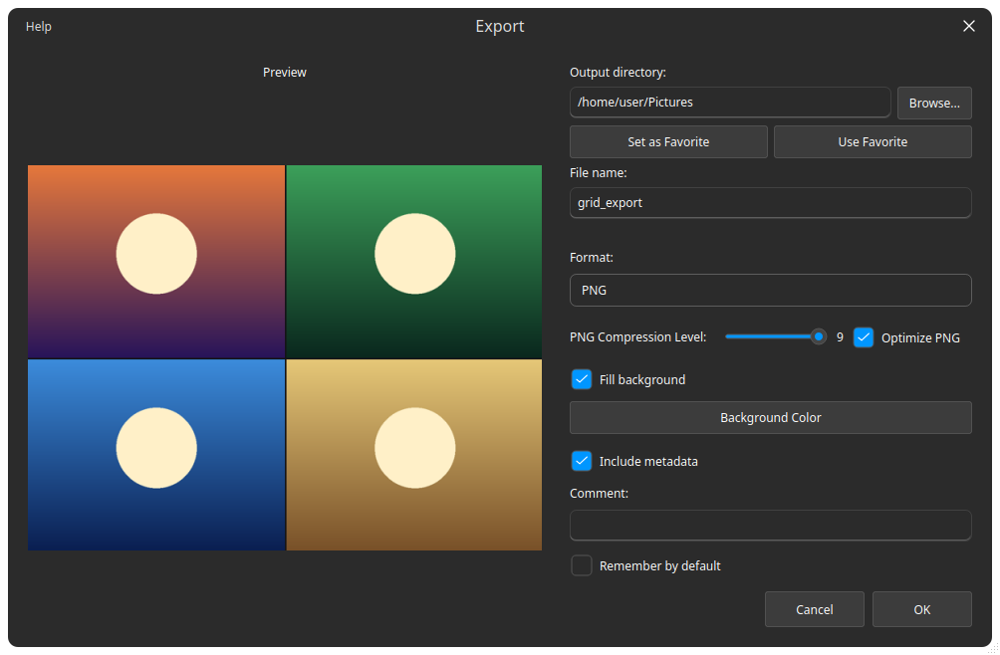

## 多图比较导出

网格会保存为一张图像，会话会保留它的网格，因此重新打开时会恢复。

### 保存与导出 {#save-and-export}

- **快速保存**（`Ctrl+S`）— 用上次使用的设置写入图像，不弹出对话框。
- **保存网格** — 通过**查找操作**打开保存对话框；见[导出](help://workspace.export)。
- **结果** — 保存的图像显示屏幕上所见的网格。
- **Crop** — 各槽位的裁剪会在槽位合并之前应用。
- **空槽位** — 没有图像的槽位不会出现在保存的图像中。
- **大尺寸导出** — 如果较长边超过 16384 px，会弹出警告询问是否继续，因为更大尺寸尚未测试，导出可能失败或内存不足。**取消** 会停止导出；**不再显示** 会为后续导出关闭该警告。

:::figure{side=block width=100%}

**保存网格** 打开的保存对话框：左侧是合并后网格的预览，右侧是输出目录、文件名、格式和 PNG 选项。
:::

### 会话 {#sessions}

会话存储各槽位的图像路径和标签、布局、聚焦的槽位、缩放和平移，以及标签和分割线样式。图像文件本身不会被复制——会话会从磁盘上的路径重新打开它们。

- **重新打开** — 重新打开的会话会立即显示它的槽位，并从各自的路径载入图像；未激活的会话会在变为激活时载入其图像。
- **新会话** — 新会话以最近使用的分割线和标签样式开始。
