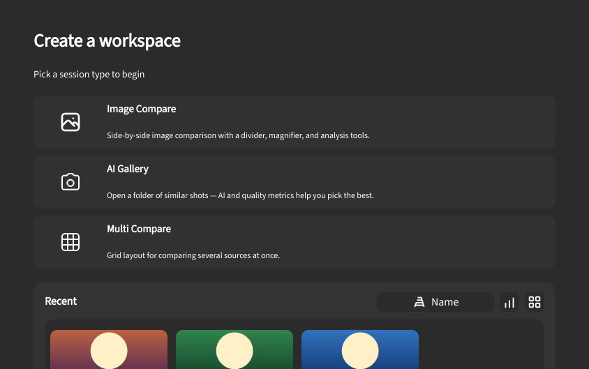

## Выбор сессии и вкладки

Стартовая страница новых вкладок и истории проектов.

### Выбор сессии {#session-picker}

- **Типы сессий** — карточки всех подключенных вкладок, например {{tr:workspace.session_types.image_compare}}, {{tr:image_gallery.tab_name}}.
- **Недавние** — проекты ``.imgsli``. Клик открывает; ПКМ: открыть, свойства, убрать, показать в папке.
- **Файл проекта** — перетаскивание файла проекта на панель закрепляет его в списке без открытия.
- **Сортировка и вид** — сетка или список, сортировка по дате или имени.
- **Превью** — миниатюра холста из ``preview.png`` в проекте, если есть.

### Клавиатура {#keyboard}

Стрелки — перемещение между карточками, `Enter` — открыть выбранный проект. Полный список — в разделе [Горячие клавиши](help://platform.hotkeys#keyboard-navigation).

:::figure{side=block width=420}

{{tr:action.workspace.open_session_picker}} — {{tr:workspace.session_types.image_compare}} / {{tr:workspace.session_types.multi_compare}}.
:::

### Открыть сессию без выбора {#new-session-actions}

Через {{tr:menu.find_action}} (`Ctrl+Shift+P`):

- {{tr:action.workspace.new_image_compare}}
- {{tr:action.workspace.new_multi_compare}}

{{tr:action.workspace.open_session_picker}} возвращает на стартовую страницу, когда удобнее выбрать визуально.

### Дальше по темам {#next-topics}

Короткие сценарии: [С чего начать](help://platform.getting_started). Инструменты сессии: [Сравнение](help://workspace.image_compare.comparison) или [{{tr:workspace.session_types.multi_compare}}](help://workspace.multi_compare.overview).
